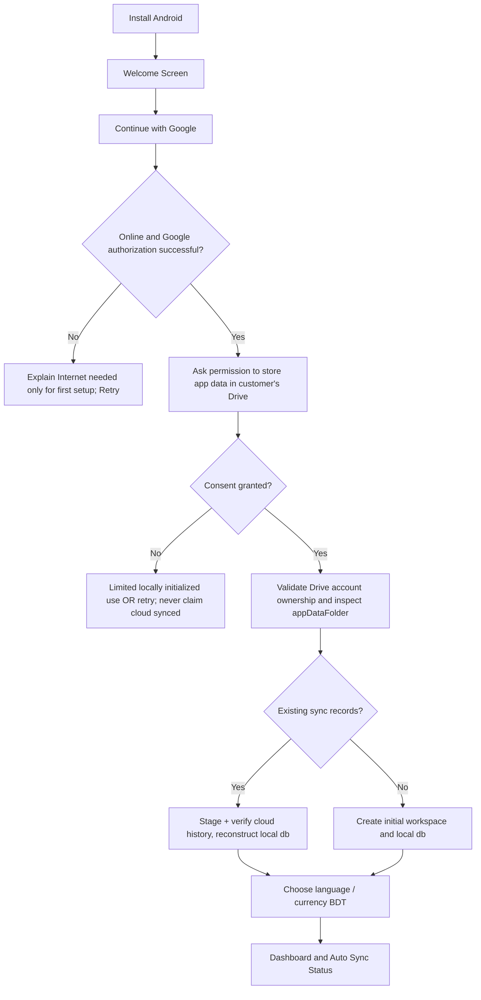
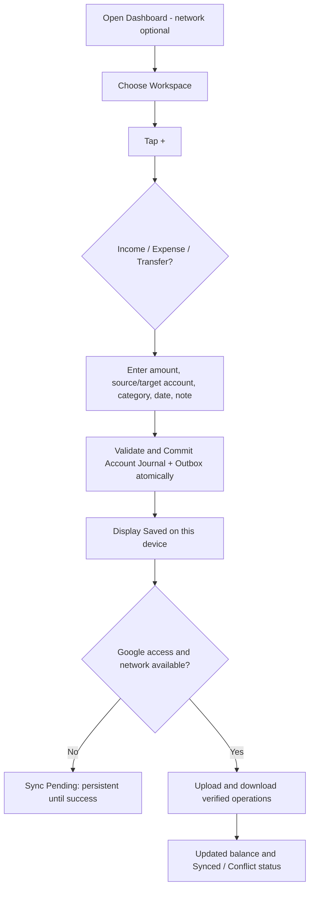

# 02 — CUSTOMER JOURNEYS, SCREEN MAP & DESIGN SPEC

## 1. Customer first-run, Android

**UX exception:** If no local dataset exists and no Internet, the Google-only first-run cannot finish. Show a friendly first-use connectivity explanation. No customer OAuth/API setup, no Recovery Key; do not show an empty dashboard that might produce unsafely orphaned records.

## 2. Daily operation journey

**Illustrative:** salary ৳25,000 Cash → expense ৳1,200 Food → cash movement +৳23,800 (if no other transactions). Account-to-account transfer principal is not counted as income/expense; only optional transfer fees are an expense.

## 3. Two-device journey
1. Android A offline records expense ৳350; local SQLite + outbox commit.
2. Android B offline records income ৳900 on same Google identity but own device UUID.
3. A reconnects and uploads immutable operation batch to its Google Drive. Last status 'Synced to Drive' only after remote verification.
4. B reconnects, downloads new A operation; uploads B operation; deduplicates by `op_id` and reconciles.
5. A syncs again to receive B's operation. Both eventually show the same history and balance **after all changes merge**.
6. If both correct the same earlier posted transaction concurrently, don't silently choose last-writer-wins: preserve original plus both proposed corrections and show **Needs Review** (accounting totals remain based on last unambiguous posted state).

## 4. Device replace / reinstall
1. Customer installs app; taps Continue with Google; gives Drive scope if asked.
2. App confirms stable Google account ID matches sync data owner and detects cloud change segments/checkpoint.
3. New empty local DB receives **staged** validated import; verify checksums, op uniqueness, journal balancing, counts and high-watermarks.
4. Atomic switch of staged restored DB; show last cloud operation time and any unavailability/partial gaps. Do **not** claim recovered records that never reached Drive.
5. Future local writes proceed normally; no recovery key in V1.

## 5. App upgrade (including when offline)
- Android OS replaces app binary without wiping private app data in normal same-ID/signed update.
- First launch: detect DB schema version; capture SQLite-consistent local recovery snapshot; run transactional incremental migration; verify rows, totals, outbox count and referential constraints.
- If migration fails: leave last readable dataset intact, show safe recovery mode; **never** call destructive fallback. Sync must wait if schema incompatible.
- Complete migration then resume queued sync without changing operation UUIDs.
- Cloud checkpoints and historical op logs are immutable and stay available until explicit retention-safe housekeeping.

## 6. Screen inventory and implementation priority
| ID | Screen/flow | Android V1? | Notes |
|---|---|---|---|
| A01 | Splash / Welcome | YES | Icon and one-sentence value |
| A02 | Google Account chooser | YES | Google-managed picker, no password field |
| A03 | Drive consent + permission explanation | YES | Narrow scope only |
| A04 | Existing data detection & staged restore | YES | Safe progress and status |
| A05 | Initial locale/BDT/workspace | YES | Bangla default |
| A06 | Home Dashboard | YES | accounts total, income, expense, recent |
| A07 | Workspace switch/list/create/edit | YES | one owner, many isolated labels |
| A08 | Ledger & group list/detail | YES | book organisation |
| A09 | Account list/create/edit/detail | YES | cash/bank/wallet |
| A10 | Category/subcategory list/edit | YES | safe default seeds |
| A11 | Transaction + fast add tab | YES | Income / Expense / Transfer |
| A12 | Transaction history/details/search/filter | YES | range/account/category/status |
| A13 | Correction / reverse entry | YES | no silent journal overwrite |
| A14 | Report overview/date/account/category | YES | no cross-workspace leakage |
| A15 | CSV export/OS share sheet | YES | local data works offline |
| A16 | Sync status/Retry/Pausing & account identity | YES | visible last success/pending/errors |
| A17 | Settings/language/theme/app lock/logout | YES | warn unsynced when switching |
| A18 | Conflict review/resolution | YES | safe rather than silent LWW |
| A19 | Storage low/Drive quota/token expired/error | YES | recoverable |
| A20 | Safe migration failure/recovery mode | YES | preserve original data |
| A21 | Empty states/accessibility help | YES | no blank dead-ends |
| B01 | Budget and alerts | YES | V1 functional local and sync |
| B02 | Recurring schedules | YES | V1; dedupe by rule ID + due date |
| B03 | Receipt attachment | YES* | V1 if attachment sync passes gate; otherwise documented BLOCKER |
| B04 | XLSX/PDF/calendars | YES | V1 export/calendar |
| B05 | Advanced accounting reconciliation / foreign currency | LATER | P1/P2 |
| B06 | Team approval/multi-user roles | LATER | needs new authorization model |

**Navigation:** bottom bar `Home | Accounts | + Add | History | Reports`. `Workspace` is a compact top menu. Settings, Ledgers, Categories, Sync Status are in More/profile or reachable from Home; 5 bottom tabs do not imply five separate codebases.

## 7. Visual design system
- Brand: Hisab DekhteChai — হিসাব দেখতে চাই; tagline: আপনার সব হিসাব, এক জায়গায়।
- Colors: primary #1D4ED8, deep #1E3A8A, pale #DBEAFE, background #F8FAFC, surface #FFFFFF, text #0F172A, secondary #64748B, border #E2E8F0.
- Outline icons from **one** Lucide family; icons mean things, not decoration: wallet, receipt, trending-up, trending-down, arrows-left-right, search, calendar, cloud-upload, cloud-check, alert-circle, lock.
- Money amount numerals monospaced/tabular; negative expense always clearly marked. Distinguish current balance, net flow, income, revenue and profit.
- Card corners 12–16px, consistent spacing 4/8/12/16/24, minimum accessible controls, safe-area insets, accessible labels and focus.
- Dark theme optional after V1 core; light blue/white default. Do not copy Money Ledgers' copyrighted designs or artwork.

## 8. Mandatory UX states per screen
`idle`, `loading`, `saved_local`, `sync_pending`, `syncing`, `synced_verified`, `auth_required`, `quota_full`, `network_unavailable`, `corrupt_remote`, `conflict`, `migration_blocked`, `storage_full`, `empty`, `error_retryable`, `error_fatal`. Never tell the user 'All synced' based only on an upload request being sent.
