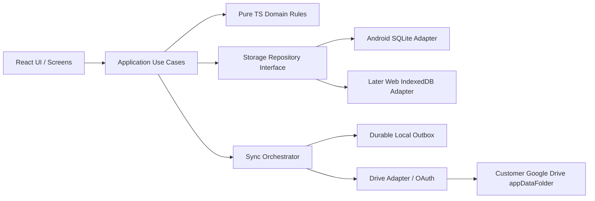

# 03 — CROSS-PLATFORM ARCHITECTURE (ANDROID FIRST)

## 1. Chosen design
- **Shared presentation/domain:** TypeScript + React + Vite + Tailwind + Lucide; Capacitor Android shell. Reuse TypeScript finance domain and sync logic for Web phase.
- **Android authoritative local source of truth:** SQLite via a maintained Capacitor SQLite bridge (verify exact package versions, Android ABI and dependency support during spike). Native durable transactions and Android storage private to this application ID.
- **Web phase source of truth:** IndexedDB-backed implementation of the same `FinanceRepository` and `SyncRepository` contracts, with browser storage caveats; use a well-maintained adapter. No platform-specific SQLite calls in React components.
- **Drive sync:** Google OAuth + Drive REST API from user device, no custom server. Google Cloud API project exists once for OAuth, **not a database**.
- **Android background:** native Android WorkManager worker, connectivity constraint + exponential backoff; ensure native token acquisition and database access actually work without active JS WebView. Fallback to best-effort foreground sync if blocked by OS/token/bridge restrictions.
- **Account identity:** Google stable subject (`sub`) from validated sign-in identity; do not identify user by mutable display name/email alone. Owner-scoped local dataset partition keyed to verified identity.

## 2. Dependency boundaries

React components must not hold OAuth secrets, construct raw SQL, or directly write/overwrite cloud snapshots. Only use typed service contracts.

## 3. Suggested monorepo layout
```text
hisab-dekhtechai/
  apps/
    android/                 # Capacitor config, Android native wrapper, app resources
    web/                     # Build in Web phase ONLY
  packages/
    domain/                  # money math, journal, ledger rules, validation
    contracts/               # FinanceRepository, SyncTransport, AuthPort types
    storage-sqlite/          # Android native adapter and migrations
    storage-web/             # later IndexedDB adapter
    sync-core/               # operation format, merge, outbox, integrity
    google-drive/            # Drive API adapter and file protocol
    design-system/           # shared blue/white UI, icons, a11y
    test-fixtures/           # deterministic financial datasets
  docs/
  tools/
  .github/workflows/
```
One React/Vite app can serve both Android and later Web if preferred; avoid creating a web-specific runtime in Phase 1. Extract shared packages from day one.

## 4. Required TypeScript interfaces (conceptual)
```ts
export type Paisa = bigint; // serialize as decimal string to JSON; sqlite store signed 64-bit integer with safe bridging
export type UUID = string;
export interface FinanceRepository {
  withTransaction<T>(fn: (tx: FinanceWriteTx) => Promise<T>): Promise<T>;
  getDashboard(workspaceId: UUID, range: DateRange): Promise<Dashboard>;
  listTransactions(filter: TransactionFilter): Promise<JournalTransaction[]>;
  getSchemaVersion(): Promise<number>;
}
export interface FinanceWriteTx {
  commitJournal(journal: BalancedJournal, outboxOperation: DurableOperation): Promise<UUID>;
}
export interface SyncTransport {
  listRemoteFiles(cursor?: string): Promise<RemotePage>;
  uploadImmutableBatch(batch: Uint8Array, remoteName: string): Promise<RemoteReceipt>;
  downloadFile(fileId: string): Promise<Uint8Array>;
}
export interface GoogleSession {
  stableSubject: string;
  authorizeDrive(): Promise<'granted' | 'denied'>;
  obtainAccessToken(): Promise<string>; // no JS-bundled client secret
}
```
**Precision warning:** Capacitor/JS interfaces may lose precision if 64-bit SQLite integer is coerced to JS `number`. Serialize bigint/paisa as decimal string at adapter boundary and test near signed 64-bit limits. Validate amounts against business max safely.

## 5. Initialization ordering
1. Determine local profile/lock screen; never show previous owner's data under a different Google account.
2. On first use, require online Google identity and Drive consent; on returning Android device allow offline cached identity in guarded profile state.
3. Initialize platform DB, validate/migrate **before** enabling writes.
4. Recover pending outbox, incomplete staging, remote cursor; verify local integrity.
5. Render cached dashboard; schedule background/foreground sync separately.
6. Sync updates trigger reactive store refresh; no reload required.

## 6. Platform runtime constraints
- **Android:** background worker lifecycle is controlled by Android; no 'sync immediately on Wi‑Fi' guarantee. `PeriodicWorkRequest` cannot give arbitrary instant frequency; Android optimization and auth state may defer it.
- **Web later:** service worker provides offline static shell but cannot guarantee scheduled Drive API sync or silent OAuth when tab is closed. Tokens short-lived, user interaction may be needed.
- **Cloud:** Drive API stores files, not transactional database rows; handle quota, eventual visibility, duplicate filenames, `403`, `401`, `429`, and user deletion.
- **Release:** use single Play signing/application ID throughout production. Local data is usually retained on a properly signed in-place Android app upgrade, not uninstall/reinstall.

## 7. Architectural decisions requiring early proof
**SPK-01** Android Credential Manager or Google Identity + Drive authorization with correct public OAuth client; consent revocation and reauthorization.  
**SPK-02** Two real devices using the same owner's **appDataFolder** with distinct Android OAuth client and later Web OAuth client from one Google Cloud application/project; verify cross-client file visibility, scopes and account binding.  
**SPK-03** Capacitor SQLite Android works across app restarts and offline mode and supports safe schema migration/recovery; cross-platform bigint precision.  
**SPK-04** Native WorkManager Drive sync works with access tokens while WebView is not active, or deliberately degrade to foreground-only with correct status.  
**SPK-05** Drive can store and list many immutable batches without destructive compaction; benchmark API cost and pagination; add compact checkpoints only after proof.

**Stop rule:** If a spike fails, explain the technical blocker and provide a safer compatible alternative for owner approval; do not pretend the requirement works.
