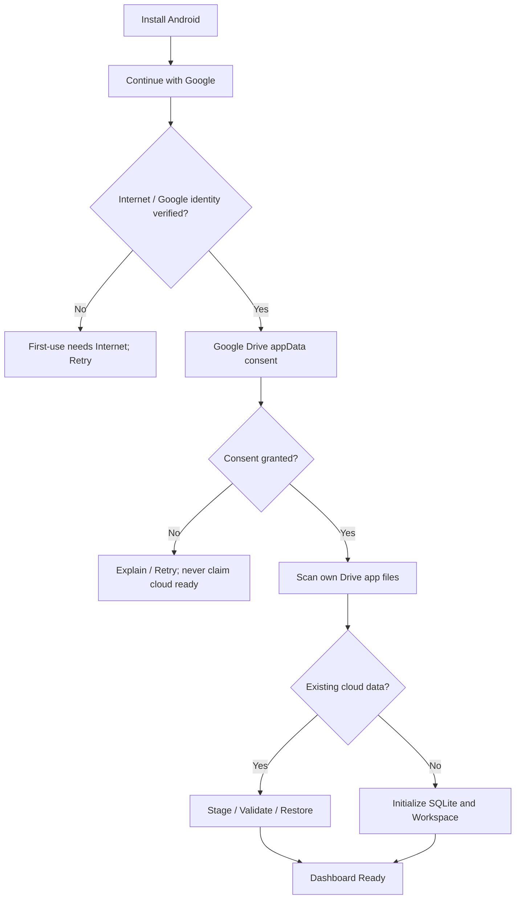
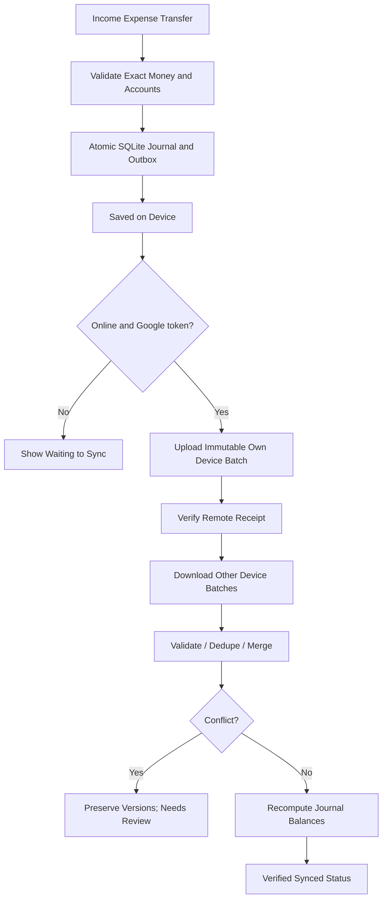
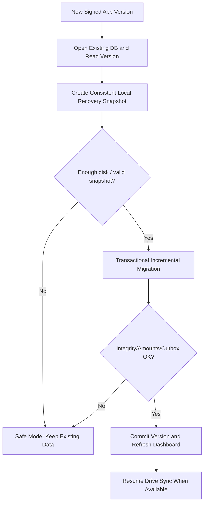
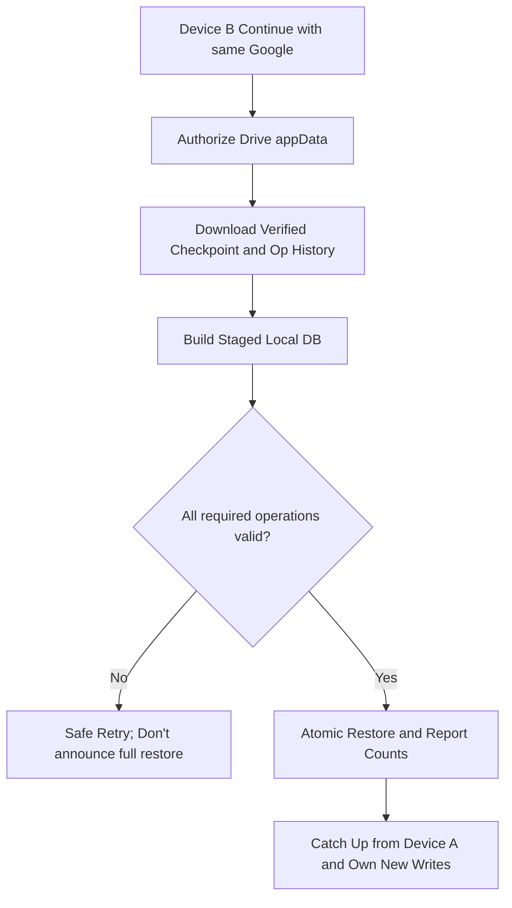

# 13 — MASTER FLOWCHART REFERENCE
This file holds condensed Mermaid workflows for designers, engineering agents and QA.

## 1. Release pipeline

```mermaid
flowchart LR
 A[Android Repo and UI] --> B[SQLite and Finance Engine]
 B --> C[Google Login and Drive Consent]
 C --> D[Two Android Device Sync]
 D --> E[Update Protection and Restore]
 E --> F[Android QA and Play Release]
 F --> G[Shared Contracts Frozen]
 G --> H[Web UI and IndexedDB]
 H --> I[Android Web Sync Test]
 I --> J[Web QA and Deployment]
```

## 2. Login and bootstrap

## 3. Offline local write and eventual sync

## 4. Safe app update / crash recovery

## 5. Second device onboarding

