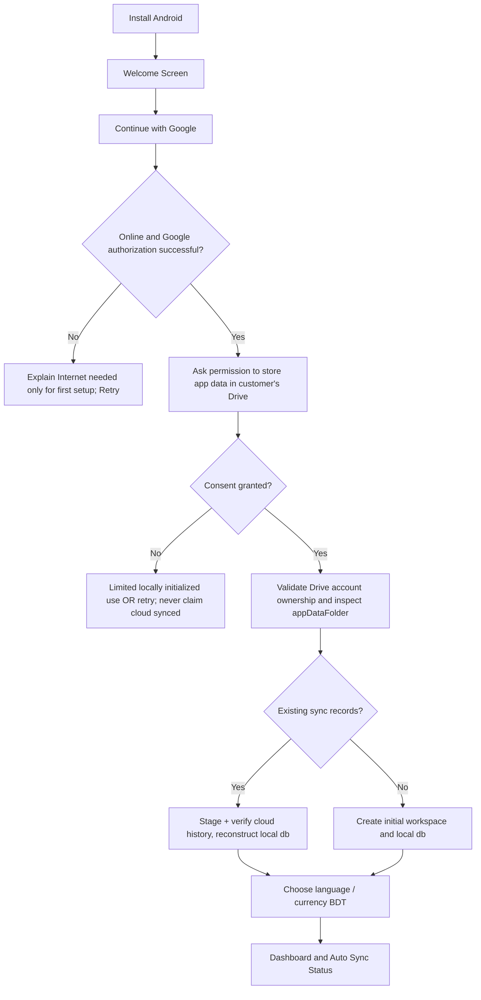
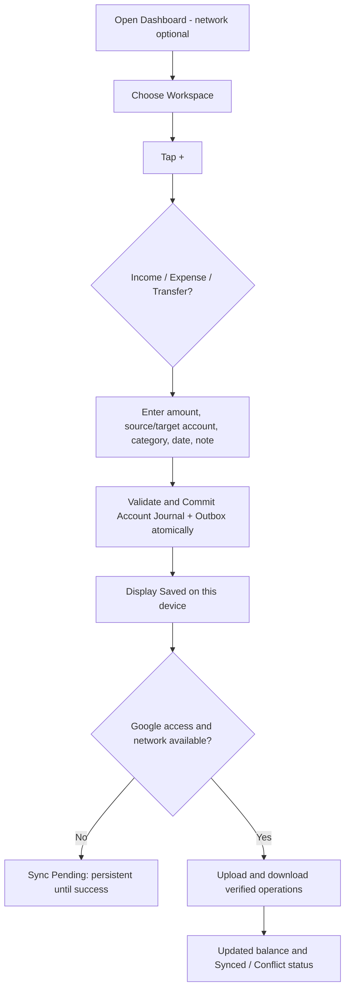
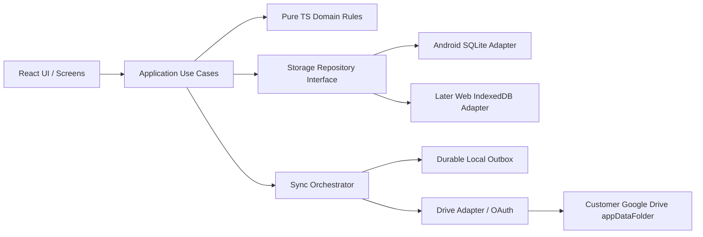
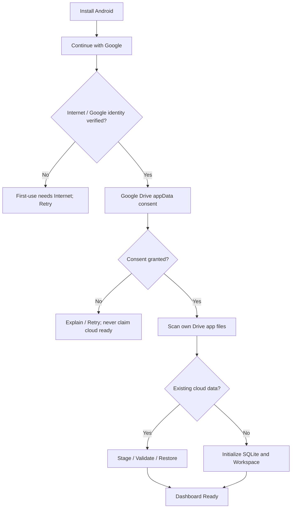
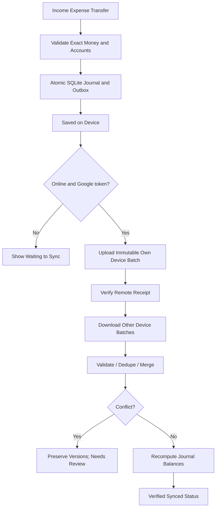
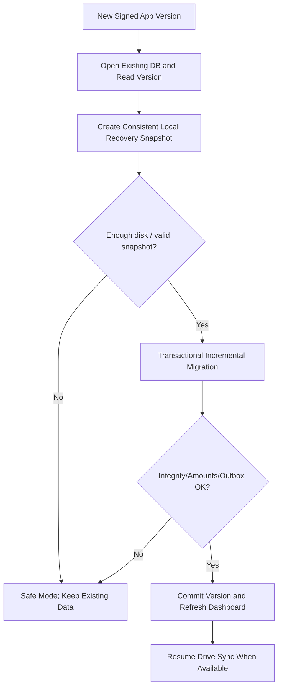
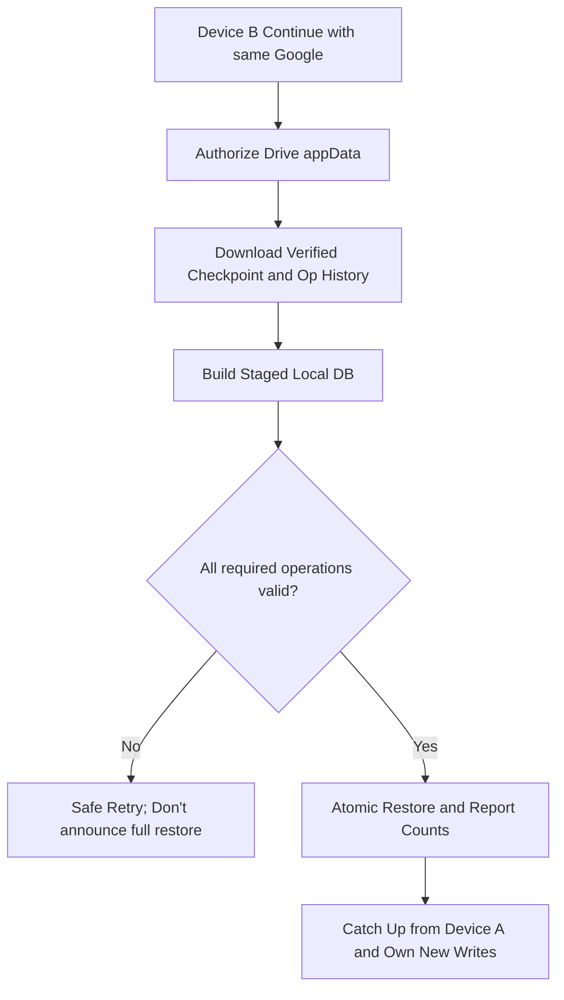

# Hisab DekhteChai — MASTER DEVELOPMENT DOCUMENT
**Android-first → Web-second | Offline Finance + Google Drive Sync | 2026-10-22**

All documents are proposed implementation specifications for a Coding Agent, not evidence of code, testing, OAuth setup, deployment or Play publishing. Modular files in the ZIP are preferred for implementation.

## Contents
- `00_BANGLA_OVERVIEW.md`
- `00_README_START_HERE.md`
- `01_PRODUCT_PRD.md`
- `02_CUSTOMER_FLOWS_UI.md`
- `03_ARCHITECTURE.md`
- `04_DATA_MODEL_FINANCE.md`
- `05_GOOGLE_DRIVE_SYNC.md`
- `06_SECURITY_AND_PRIVACY.md`
- `07_ANDROID_DEVELOPMENT.md`
- `08_WEB_DEVELOPMENT_LATER.md`
- `09_QA_ACCEPTANCE_RELEASE.md`
- `10_AGENT_MASTER_PROMPT.md`
- `11_DECISIONS_RISKS_OPEN_QUESTIONS.md`
- `12_GOOGLE_DEVELOPER_SETUP_AND_PLAY_RELEASE.md`
- `13_FLOWCHART_REFERENCE.md`
- `MILESTONE_CHECKLIST.md`

---


---

<!-- BEGIN 00_BANGLA_OVERVIEW.md -->

# Hisab DekhteChai (হিসাব দেখতে চাই) — ডেভেলপমেন্ট প্যাকেজের বাংলা সারাংশ

**এটি অ্যাপের সোর্স কোড নয়।** আপনার Coding Agent যাতে সম্পূর্ণ কার্যকর অ্যাপ তৈরি করতে পারে, তার জন্য বিস্তারিত প্রয়োজনীয়তা, প্রযুক্তিগত নকশা, কাজের ক্রম ও পরীক্ষার ডকুমেন্ট।

## আমরা কী তৈরি করব?
- প্রথমে **Android App**, সেটি সম্পূর্ণ তৈরি, পরীক্ষা, Google Drive Sync যাচাই ও রিলিজ প্রস্তুত হওয়ার পরে **Web App**।
- Android-এ **সম্পূর্ণ Offline হিসাব**: আয়, ব্যয়, টাকা স্থানান্তর, ক্যাটাগরি, লেজার, অ্যাকাউন্ট, রিপোর্ট, বাজেট, রিকারিং ও দরকারি অন্যান্য কাজ।
- প্রথমবার **Continue with Google** → Google Drive-এর প্রয়োজনীয় অনুমতি → এরপর স্বাভাবিক ব্যবহার। গ্রাহককে API Key বা Recovery Key দিতে হবে না।
- ইন্টারনেট থাকলে বা ফিরে এলে গ্রাহকের **নিজস্ব Google Drive**-এর মাধ্যমে Android ও পরবর্তীতে Web-এর মধ্যে **Automatic Two-Way Sync**। এটি তাৎক্ষণিক Live Sync নয়; নেটওয়ার্ক/Google-এর অনুমতি ও ডিভাইসের সীমাবদ্ধতা অনুযায়ী সম্পন্ন হবে।
- Supabase, Firebase Database, আলাদা অনলাইন হিসাব সার্ভার এবং Windows Native App থাকবে না।
- অ্যাপ আপডেট করার সময় SQLite Data, অনলাইন না হওয়া হিসাব, Sync Queue এবং পুরোনো Ledger অক্ষত রাখার **নিরাপদ Migration ও Recovery ব্যবস্থা** থাকবে।
- **Minimal Blue & White** ডিজাইন, একই ধরনের Outline Icons, বাংলা ভাষা প্রধান।

## Coding Agent কীভাবে কাজ করবে?
1. `00_README_START_HERE.md` পড়বে, তারপর 01–13 ডকুমেন্ট অনুসরণ করবে।
2. Android Repository, UI, SQLite ও সঠিক Accounting Engine তৈরি করবে।
3. Google Login এবং গ্রাহকের নিজের Drive-এর Sync বাস্তবে যুক্ত করবে।
4. দুই ফোনে অফলাইন হিসাব যোগ করে পরে Sync-এর পরীক্ষা করবে—ডুপ্লিকেট বা হারানো ডেটা চলবে না।
5. পুরোনো অ্যাপ ভার্সন আপডেট, Recovery, Storage Full, Wrong Google Account ও Crash Test করবে।
6. Android Production-Ready Build, QA Evidence ও Play Store Release Checklist প্রস্তুত করবে।
7. Android পর্যায় সফল হওয়ার পর Web App-এর কাজ শুরু করবে।

## গ্রাহকের অভিজ্ঞতা
`অ্যাপ ইনস্টল → Continue with Google → Drive অনুমতি → Dashboard → Offline আয়/ব্যয় → স্থানীয়ভাবে সেভ → অনলাইন হলে Drive Auto Sync → অন্য ডিভাইসে একই Google Account দিয়ে হিসাব পাওয়া`।

## গুরুত্বপূর্ণ নিরাপত্তার সত্যতা
- কোনো অ্যাপ ১০০% ডেটা সুরক্ষার নিশ্চয়তা দিতে পারে না; তাই নিরাপদ Local Database, Versioned Cloud Backup, Crash Recovery ও পরীক্ষার ব্যবস্থা জরুরি।
- **Recovery Key ছাড়া V1-এ Zero-Knowledge বা End-to-End Encryption দাবি করব না**। Google-এর নিরাপত্তা, সীমিত Drive অনুমতি, HTTPS এবং ডিভাইসের নিজস্ব সুরক্ষা ব্যবহার করব।
- গ্রাহক ইন্টারনেট ছাড়া নতুন ডিভাইসে প্রথম Google Sign-in করতে পারবেন না। পুরোনো সেটআপ করা Android ডিভাইসে অফলাইনে কাজ পারবেন।
- Google Drive-এ Sync না হওয়া হিসাব যদি ফোন নষ্ট হওয়ার আগে আপলোড না হয়, নতুন ফোনে সেটি উদ্ধার নাও হতে পারে। অ্যাপ Pending Sync সতর্কতা দেখাবে।
- এক Google মালিকের Personal ও Business Workspace প্রথম ভার্সনে থাকবে। একাধিক কর্মীর শেয়ার করা হিসাব ও Approval System ভবিষ্যতে আলাদা নিরাপত্তা ব্যবস্থা ছাড়া চালু করা হবে না।

## বর্তমানে কাজের অবস্থা
ডকুমেন্ট প্রস্তুত। Android অ্যাপের কোড, বাস্তব Google OAuth/Drive Integration, APK/AAB Build, Tester Verification, Web App বা Play Store Publish এই ডকুমেন্ট তৈরি করার অংশ হিসেবে করা হয়নি। Coding Agent-কে এসব প্রকৃতপক্ষে বাস্তবায়ন ও পরীক্ষা করতে হবে।


<!-- END 00_BANGLA_OVERVIEW.md -->


---

<!-- BEGIN 00_README_START_HERE.md -->

# Hisab DekhteChai — Android-first Developer Handoff
**Release plan:** Android complete → Android QA & beta → Web App → production Web release  
**Document baseline:** 2026-10-22 | **Package:** v1.0 / design-approved specification | **Implementation status:** NOT STARTED

> **Product:** Hisab DekhteChai (হিসাব দেখতে চাই) — a Bangla-first, minimal blue/white, offline-first finance tracker. The customer logs in with Google, works offline after initial setup, and syncs automatically to **their own** Google Drive when conditions permit. No Supabase/Firebase database, no custom central finance backend, no native Windows app, no recovery key in V1.

## DOCUMENT ORDER — Coding Agent must follow
| Order | File | What to implement/decide |
|---|---|---|
| 1 | `01_PRODUCT_PRD.md` | Immutable product requirements, scope, acceptance criteria |
| 2 | `02_CUSTOMER_FLOWS_UI.md` | Exact customer journeys, navigation, screen states |
| 3 | `03_ARCHITECTURE.md` | Monorepo, runtime boundaries, offline lifecycle, interfaces |
| 4 | `04_DATA_MODEL_FINANCE.md` | Data model, immutable financial journal, migration policy |
| 5 | `05_GOOGLE_DRIVE_SYNC.md` | Durable outbox, append-only segment format, two-way eventual sync, bootstrap |
| 6 | `06_SECURITY_AND_PRIVACY.md` | Google OAuth consent, threat model, data protection and limitations |
| 7 | `07_ANDROID_DEVELOPMENT.md` | **Build this FIRST**; exact ordered Android milestones and release gates |
| 8 | `08_WEB_DEVELOPMENT_LATER.md` | **Do not implement until Android gates PASS**; web reuse plan |
| 9 | `09_QA_ACCEPTANCE_RELEASE.md` | Test matrices, CI, disaster simulations, Play Store preparation |
| 10 | `10_AGENT_MASTER_PROMPT.md` | Copy-and-paste instructions to Claude/Codex/Coding Agent |
| 11 | `11_DECISIONS_RISKS_OPEN_QUESTIONS.md` | Locked decisions and engineering spike gates |
| 12 | `12_GOOGLE_DEVELOPER_SETUP_AND_PLAY_RELEASE.md` | Exact one-time OAuth/Drive developer steps and Play policy |
| 13 | `13_FLOWCHART_REFERENCE.md` | Concise Mermaid diagrams |

**Other included materials:** `MASTER_DEVELOPMENT_DOCUMENT.md` (all documentation in a single file), `MILESTONE_CHECKLIST.md` (track task status). Earlier user-journey notes are superseded by the decisions in this package whenever they differ.

## Hard requirements that override any previous plans
1. Android **first**, Web second **automatically after all Android development/QA gates PASS**; do not create native Windows/iOS apps in V1.
2. **No server-owned financial database.** Google Drive is the user's own transport/storage for sync; Google Cloud is configured once by the **developer**, never by the customer.
3. V1 onboarding: **Continue with Google** and Google's necessary authorization prompts only; **no customer API keys, custom password, or Recovery Key**.
4. After first online sign-in, Android must record, show, filter and report data **fully offline**. A local write must never wait for Drive.
5. Two-way **eventual** synchronization: Android device A ↔ own Drive ↔ Android B / future Web. *Not* instant realtime. Background delivery is best-effort.
6. No silent deletion, overwrite or destructive migration of financial records during sync, app upgrade, restore or account switch.
7. Enforce **single Google owner identity per dataset** in V1. Personal/business ledgers are separate *within the same owner's app*. Team membership and approvals are **deferred**, as user-owned Drive cannot safely implement shared role-based access without further design.
8. The UI is **minimal blue and white** with consistent **Lucide-style outline icons**, Bangla primary, English optional, accessible, responsive.
9. Financial computations use **integer BDT minor units (paisa)**. Post balanced ledger entries transactionally; no JavaScript floating-point money arithmetic.
10. Every milestone includes proof: screenshots, code diffs, tests, passing evidence, unresolved issues, and next steps. No fictitious "PASS" statuses.

## Out-of-scope claims that must NOT be made
- "100% secure", "instant sync", "Google cannot read cloud data", "encrypted end-to-end" — NOT established in V1.
- "Automatic Web sync while the browser is closed" — cannot be guaranteed.
- "Google sign-in without Internet on a fresh device" — initial connection required.
- "All sync conflicts can be silently merged" — conflicts require safe review.
- "APK update cannot possibly lose data" — risk reduction and tested recovery required, not absolute guarantee.

## Initial implementation deliverables (not yet produced)
- Git repository with pinned, tested dependency versions, Android build and preview release, deterministic local database migrations, Google Identity authorization, real Drive-to-Drive multi-device proof, automated tests, CI, user-facing privacy policy, release checklist and recorded beta test.
- Work **sequentially** through Android phase milestones before beginning Web implementation. Stop before production releases unless owner authorizes.

## Important prerequisites — one-time developer actions
- Create Google Cloud project with Drive API enabled, OAuth consent screen, Android app OAuth client (package + signing SHA), later Web OAuth client (authorized origins). Submit Google verification if applicable.
- Reserve/verify Android application ID and brand usage, configure Play Console, configure developer-keystore security.
- Ensure exact Android SDK/Google Play target SDK level is rechecked at release time.

## Verified official documentation used
- Drive scope options: https://developers.google.com/workspace/drive/api/guides/api-specific-auth
- Hidden app data folder: https://developers.google.com/workspace/drive/api/guides/appdata
- Drive change feed: https://developers.google.com/workspace/drive/api/guides/manage-changes
- Drive quota/errors: https://developers.google.com/workspace/drive/api/guides/handle-errors
- Android DB migrations: https://developer.android.com/training/data-storage/room/migrating-db-versions
- Google Play target SDK: https://developer.android.com/google/play/requirements/target-sdk


<!-- END 00_README_START_HERE.md -->


---

<!-- BEGIN 01_PRODUCT_PRD.md -->

# 01 — PRODUCT REQUIREMENTS DOCUMENT (PRD)
**Name:** Hisab DekhteChai / হিসাব দেখতে চাই  
**Tagline:** আপনার সব হিসাব, এক জায়গায়।  
**Product category:** Offline-first personal and single-owner small-business finance / expense ledger. Not a banking, payments, or money-transfer provider.

## 1. Users / use cases
- Personal user records salary, food expenses, bills, transfers, budgets, cash/bank/wallet balances.
- Small business owner creates separately labeled Personal, Business A and Business B **workspaces**. Each workspace may contain ledgers and asset accounts (Cash / bKash / Nagad / Rocket / Bank) with independent reports.
- The same individual later uses a second Android phone or Web browser, signs into **the same Google Account**, and obtains eventual synced balances without manual file import.
- User upgrades Android app from store while offline, retaining unuploaded transactions.
- User changes phone, signs into the same Google Account, and the app safely reconstructs available synced financial history.

**Single-user ownership in V1:** V1 does not offer other staff accounts, permission-based collaboration, review/approval or a central team ledger. Historical concept screens for team approval should be marked *Future / not implemented*, not dead buttons in first production release.

## 2. Success criteria
- User can add income, expense, transfer offline without spinner/network calls; transaction and outbox are one atomic local commit.
- After Google auth and Drive consent, background/foreground sync reconciles changes between two Android devices; **no lost or duplicated operations** under staged concurrency/failure tests.
- Customer does not configure Google Cloud, API credentials, recovery phrase or second app password.
- Every posted account-to-account transfer preserves consolidated funds except explicit fees.
- UX labels distinguish **Saved on device**, **Waiting to sync**, **Synced to Drive**, **Sync requires attention**, **Conflict needs review**.
- Version update preserves record IDs, account totals, queued operations, and migration integrity.
- Android accessibility: 48dp-ish touch targets, scalable fonts, keyboard/screen-reader labels and good contrast.

## 3. Platforms and release boundaries
| Release | Core promise | Don't deliver yet |
|---|---|---|
| Android Alpha | Local finance engine, offline-first UX, local migrations | public store, web |
| Android Beta | real Google Identity + Drive sync, second-device restore, safety suite | production Android, web |
| Android v1.0 | QA-gated Play Store version, audit/report/export | staff accounts / backend / E2EE |
| Web v1.0, later | React shared UI/business core, browser local DB, Google Drive pull/push while active | offline background sync with browser closed |
| Future | recurring, budgets, receipts, team approval if re-architected, optional stronger encryption/key recovery | no promise of dates |

## 4. Android V1 functional scope — must ship
1. Welcome, Google sign-in, Drive scope consent, first-run onboarding with BDT and language.
2. Personal/business workspaces for **one Google owner**; workspace switching; user-confirmed workspace create, rename, archive.
3. Ledgers and ledger groups (view classification, not security principals).
4. Asset accounts: Cash, Bank, bKash, Nagad, Rocket, Other; opening balances.
5. Categories/subcategories with defaults and custom entries.
6. Fast entry: Income, Expense, Transfer (optional fee), relevant date, note, workspace/account; validate inputs.
7. Transaction history, details, reversible correction, archive filters, search and period filters.
8. Dashboard: per-workspace total account balance, income, expense, net movement, top categories, recent transactions; no conflation of balance and profit.
9. Reports: day/week/month/custom date, by account/ledger/category; CSV export; no currency mixing (V1 BDT only).
10. Sync dashboard: sync state, last successful verification, pending count, last error category, manual Retry, Pause sync, Drive account identity.
11. Automatic local update-safe DB migrations; local recovery snapshots; cloud checkpoint/backups; restored history validation.
12. Settings: Bangla/English UI, dark mode optional, app lock PIN/biometrics optional, logout with clear explanation about local data and unsynced records.
13. Budget management (monthly/weekly/category cap), spending progress and locally scheduled alert state.
14. Recurring income/expense templates with deterministic `(rule_id, due_date)` occurrence identity, no double-post across offline devices; safe preview/confirmation policy.
15. Financial calendar, bookmark/archive, basic reconciliation, XLSX/PDF export (or owner-approved documented deferral if library/security constraints block).
16. Receipt attachment: local import/view, content-size/type validation, separate immutable Drive blob replication + referenced operation with delayed-attachment UI; implement if attachment protocol passes Drive quota/load testing, else label blocked rather than pretending attachments sync.
17. Error/empty/loading/offline/account-mismatch/conflict/recovery flows. Never leave empty screen or silent failures.

## 5. P1 / postponed (do not fake by showing unusable UI)
- Multi-currency, advanced accounting reconciliation, cross-ledger comparison, sophisticated recurring automation beyond tested local-first rule execution.
- Approval, team roles, multi-user accounting and permission logs require a new shared identity/authorization model; **not part of V1**.
- Banking integration, monetary transfers via payment providers, payment processing, lending, OCR, ads, paid subscription and native Windows/iOS not required.

## 6. UX rules and phrasing
- Bangla-first, international standard numeral display via settings, BDT currency `৳`.
- Blue primary `#1D4ED8`, navy `#1E3A8A`, white `#FFFFFF`, blue-muted `#DBEAFE`, background `#F8FAFC`, slate text `#0F172A`; green/red solely semantic, not dominant.
- Lucide outline icon pack, one icon stroke weight; skeletons only on loading, avoid resource-heavy animation.
- Backups never automatically overwrite unsynced local edits during restore.
- Google Drive `appDataFolder` hides system sync files from Drive UI; "my Google Drive" is honest but not "visible folder". Offer user-visible manual export later via Drive file picker / local download.

## 7. Behavioral rules
- Google OAuth is not needed for each transaction; local device retains authenticated ownership marker after initial sign-in.
- Cannot create brand-new cloud-backed identity offline; existing initialized Android accounts can perform local work offline.
- Account switch requires verified online Google identity and inspection of pending outbox; never reuse another account's local DB.
- If Drive consent is denied/revoked, allow local use on already initialized device, show "Backup paused"; do not say synced.
- Sync is on app foreground/open, network regained, periodic permitted Android worker, and manual retry. Background scheduling is advisory, not exact or immediate.

## 8. Definition of done
**Android finished** only when actual signed builds on representative Android devices pass the release matrix, second-device sync verification, restore and migration, Google OAuth consent flows, privacy/Play checks; QA artifacts committed and release approved. Then begin Web phase.


<!-- END 01_PRODUCT_PRD.md -->


---

<!-- BEGIN 02_CUSTOMER_FLOWS_UI.md -->

# 02 — CUSTOMER JOURNEYS, SCREEN MAP & DESIGN SPEC

## 1. Customer first-run, Android

**UX exception:** If no local dataset exists and no Internet, the Google-only first-run cannot finish. Show a friendly first-use connectivity explanation. No customer OAuth/API setup, no Recovery Key; do not show an empty dashboard that might produce unsafely orphaned records.

## 2. Daily operation journey

**Illustrative:** salary ৳25,000 Cash → expense ৳1,200 Food → cash movement +৳23,800 (if no other transactions). Account-to-account transfer principal is not counted as income/expense; only optional transfer fees are an expense.

## 3. Two-device journey
1. Android A offline records expense ৳350; local SQLite + outbox commit.
2. Android B offline records income ৳900 on same Google identity but own device UUID.
3. A reconnects and uploads immutable operation batch to its Google Drive. Last status 'Synced to Drive' only after remote verification.
4. B reconnects, downloads new A operation; uploads B operation; deduplicates by `op_id` and reconciles.
5. A syncs again to receive B's operation. Both eventually show the same history and balance **after all changes merge**.
6. If both correct the same earlier posted transaction concurrently, don't silently choose last-writer-wins: preserve original plus both proposed corrections and show **Needs Review** (accounting totals remain based on last unambiguous posted state).

## 4. Device replace / reinstall
1. Customer installs app; taps Continue with Google; gives Drive scope if asked.
2. App confirms stable Google account ID matches sync data owner and detects cloud change segments/checkpoint.
3. New empty local DB receives **staged** validated import; verify checksums, op uniqueness, journal balancing, counts and high-watermarks.
4. Atomic switch of staged restored DB; show last cloud operation time and any unavailability/partial gaps. Do **not** claim recovered records that never reached Drive.
5. Future local writes proceed normally; no recovery key in V1.

## 5. App upgrade (including when offline)
- Android OS replaces app binary without wiping private app data in normal same-ID/signed update.
- First launch: detect DB schema version; capture SQLite-consistent local recovery snapshot; run transactional incremental migration; verify rows, totals, outbox count and referential constraints.
- If migration fails: leave last readable dataset intact, show safe recovery mode; **never** call destructive fallback. Sync must wait if schema incompatible.
- Complete migration then resume queued sync without changing operation UUIDs.
- Cloud checkpoints and historical op logs are immutable and stay available until explicit retention-safe housekeeping.

## 6. Screen inventory and implementation priority
| ID | Screen/flow | Android V1? | Notes |
|---|---|---|---|
| A01 | Splash / Welcome | YES | Icon and one-sentence value |
| A02 | Google Account chooser | YES | Google-managed picker, no password field |
| A03 | Drive consent + permission explanation | YES | Narrow scope only |
| A04 | Existing data detection & staged restore | YES | Safe progress and status |
| A05 | Initial locale/BDT/workspace | YES | Bangla default |
| A06 | Home Dashboard | YES | accounts total, income, expense, recent |
| A07 | Workspace switch/list/create/edit | YES | one owner, many isolated labels |
| A08 | Ledger & group list/detail | YES | book organisation |
| A09 | Account list/create/edit/detail | YES | cash/bank/wallet |
| A10 | Category/subcategory list/edit | YES | safe default seeds |
| A11 | Transaction + fast add tab | YES | Income / Expense / Transfer |
| A12 | Transaction history/details/search/filter | YES | range/account/category/status |
| A13 | Correction / reverse entry | YES | no silent journal overwrite |
| A14 | Report overview/date/account/category | YES | no cross-workspace leakage |
| A15 | CSV export/OS share sheet | YES | local data works offline |
| A16 | Sync status/Retry/Pausing & account identity | YES | visible last success/pending/errors |
| A17 | Settings/language/theme/app lock/logout | YES | warn unsynced when switching |
| A18 | Conflict review/resolution | YES | safe rather than silent LWW |
| A19 | Storage low/Drive quota/token expired/error | YES | recoverable |
| A20 | Safe migration failure/recovery mode | YES | preserve original data |
| A21 | Empty states/accessibility help | YES | no blank dead-ends |
| B01 | Budget and alerts | YES | V1 functional local and sync |
| B02 | Recurring schedules | YES | V1; dedupe by rule ID + due date |
| B03 | Receipt attachment | YES* | V1 if attachment sync passes gate; otherwise documented BLOCKER |
| B04 | XLSX/PDF/calendars | YES | V1 export/calendar |
| B05 | Advanced accounting reconciliation / foreign currency | LATER | P1/P2 |
| B06 | Team approval/multi-user roles | LATER | needs new authorization model |

**Navigation:** bottom bar `Home | Accounts | + Add | History | Reports`. `Workspace` is a compact top menu. Settings, Ledgers, Categories, Sync Status are in More/profile or reachable from Home; 5 bottom tabs do not imply five separate codebases.

## 7. Visual design system
- Brand: Hisab DekhteChai — হিসাব দেখতে চাই; tagline: আপনার সব হিসাব, এক জায়গায়।
- Colors: primary #1D4ED8, deep #1E3A8A, pale #DBEAFE, background #F8FAFC, surface #FFFFFF, text #0F172A, secondary #64748B, border #E2E8F0.
- Outline icons from **one** Lucide family; icons mean things, not decoration: wallet, receipt, trending-up, trending-down, arrows-left-right, search, calendar, cloud-upload, cloud-check, alert-circle, lock.
- Money amount numerals monospaced/tabular; negative expense always clearly marked. Distinguish current balance, net flow, income, revenue and profit.
- Card corners 12–16px, consistent spacing 4/8/12/16/24, minimum accessible controls, safe-area insets, accessible labels and focus.
- Dark theme optional after V1 core; light blue/white default. Do not copy Money Ledgers' copyrighted designs or artwork.

## 8. Mandatory UX states per screen
`idle`, `loading`, `saved_local`, `sync_pending`, `syncing`, `synced_verified`, `auth_required`, `quota_full`, `network_unavailable`, `corrupt_remote`, `conflict`, `migration_blocked`, `storage_full`, `empty`, `error_retryable`, `error_fatal`. Never tell the user 'All synced' based only on an upload request being sent.


<!-- END 02_CUSTOMER_FLOWS_UI.md -->


---

<!-- BEGIN 03_ARCHITECTURE.md -->

# 03 — CROSS-PLATFORM ARCHITECTURE (ANDROID FIRST)

## 1. Chosen design
- **Shared presentation/domain:** TypeScript + React + Vite + Tailwind + Lucide; Capacitor Android shell. Reuse TypeScript finance domain and sync logic for Web phase.
- **Android authoritative local source of truth:** SQLite via a maintained Capacitor SQLite bridge (verify exact package versions, Android ABI and dependency support during spike). Native durable transactions and Android storage private to this application ID.
- **Web phase source of truth:** IndexedDB-backed implementation of the same `FinanceRepository` and `SyncRepository` contracts, with browser storage caveats; use a well-maintained adapter. No platform-specific SQLite calls in React components.
- **Drive sync:** Google OAuth + Drive REST API from user device, no custom server. Google Cloud API project exists once for OAuth, **not a database**.
- **Android background:** native Android WorkManager worker, connectivity constraint + exponential backoff; ensure native token acquisition and database access actually work without active JS WebView. Fallback to best-effort foreground sync if blocked by OS/token/bridge restrictions.
- **Account identity:** Google stable subject (`sub`) from validated sign-in identity; do not identify user by mutable display name/email alone. Owner-scoped local dataset partition keyed to verified identity.

## 2. Dependency boundaries

React components must not hold OAuth secrets, construct raw SQL, or directly write/overwrite cloud snapshots. Only use typed service contracts.

## 3. Suggested monorepo layout
```text
hisab-dekhtechai/
  apps/
    android/                 # Capacitor config, Android native wrapper, app resources
    web/                     # Build in Web phase ONLY
  packages/
    domain/                  # money math, journal, ledger rules, validation
    contracts/               # FinanceRepository, SyncTransport, AuthPort types
    storage-sqlite/          # Android native adapter and migrations
    storage-web/             # later IndexedDB adapter
    sync-core/               # operation format, merge, outbox, integrity
    google-drive/            # Drive API adapter and file protocol
    design-system/           # shared blue/white UI, icons, a11y
    test-fixtures/           # deterministic financial datasets
  docs/
  tools/
  .github/workflows/
```
One React/Vite app can serve both Android and later Web if preferred; avoid creating a web-specific runtime in Phase 1. Extract shared packages from day one.

## 4. Required TypeScript interfaces (conceptual)
```ts
export type Paisa = bigint; // serialize as decimal string to JSON; sqlite store signed 64-bit integer with safe bridging
export type UUID = string;
export interface FinanceRepository {
  withTransaction<T>(fn: (tx: FinanceWriteTx) => Promise<T>): Promise<T>;
  getDashboard(workspaceId: UUID, range: DateRange): Promise<Dashboard>;
  listTransactions(filter: TransactionFilter): Promise<JournalTransaction[]>;
  getSchemaVersion(): Promise<number>;
}
export interface FinanceWriteTx {
  commitJournal(journal: BalancedJournal, outboxOperation: DurableOperation): Promise<UUID>;
}
export interface SyncTransport {
  listRemoteFiles(cursor?: string): Promise<RemotePage>;
  uploadImmutableBatch(batch: Uint8Array, remoteName: string): Promise<RemoteReceipt>;
  downloadFile(fileId: string): Promise<Uint8Array>;
}
export interface GoogleSession {
  stableSubject: string;
  authorizeDrive(): Promise<'granted' | 'denied'>;
  obtainAccessToken(): Promise<string>; // no JS-bundled client secret
}
```
**Precision warning:** Capacitor/JS interfaces may lose precision if 64-bit SQLite integer is coerced to JS `number`. Serialize bigint/paisa as decimal string at adapter boundary and test near signed 64-bit limits. Validate amounts against business max safely.

## 5. Initialization ordering
1. Determine local profile/lock screen; never show previous owner's data under a different Google account.
2. On first use, require online Google identity and Drive consent; on returning Android device allow offline cached identity in guarded profile state.
3. Initialize platform DB, validate/migrate **before** enabling writes.
4. Recover pending outbox, incomplete staging, remote cursor; verify local integrity.
5. Render cached dashboard; schedule background/foreground sync separately.
6. Sync updates trigger reactive store refresh; no reload required.

## 6. Platform runtime constraints
- **Android:** background worker lifecycle is controlled by Android; no 'sync immediately on Wi‑Fi' guarantee. `PeriodicWorkRequest` cannot give arbitrary instant frequency; Android optimization and auth state may defer it.
- **Web later:** service worker provides offline static shell but cannot guarantee scheduled Drive API sync or silent OAuth when tab is closed. Tokens short-lived, user interaction may be needed.
- **Cloud:** Drive API stores files, not transactional database rows; handle quota, eventual visibility, duplicate filenames, `403`, `401`, `429`, and user deletion.
- **Release:** use single Play signing/application ID throughout production. Local data is usually retained on a properly signed in-place Android app upgrade, not uninstall/reinstall.

## 7. Architectural decisions requiring early proof
**SPK-01** Android Credential Manager or Google Identity + Drive authorization with correct public OAuth client; consent revocation and reauthorization.  
**SPK-02** Two real devices using the same owner's **appDataFolder** with distinct Android OAuth client and later Web OAuth client from one Google Cloud application/project; verify cross-client file visibility, scopes and account binding.  
**SPK-03** Capacitor SQLite Android works across app restarts and offline mode and supports safe schema migration/recovery; cross-platform bigint precision.  
**SPK-04** Native WorkManager Drive sync works with access tokens while WebView is not active, or deliberately degrade to foreground-only with correct status.  
**SPK-05** Drive can store and list many immutable batches without destructive compaction; benchmark API cost and pagination; add compact checkpoints only after proof.

**Stop rule:** If a spike fails, explain the technical blocker and provide a safer compatible alternative for owner approval; do not pretend the requirement works.


<!-- END 03_ARCHITECTURE.md -->


---

<!-- BEGIN 04_DATA_MODEL_FINANCE.md -->

# 04 — SQLITE DATA MODEL, INVARIANTS, MIGRATION STRATEGY

## 1. Goals
Exact offline financial integrity, independent workspaces under a single Google owner, stable UUIDs across devices, deterministic application of immutable sync operations, never destructive upgrade.

## 2. Data model
| Table | Key fields | Constraints/notes |
|---|---|---|
| `local_identity` | id, google_subject_hash, account_display_hint, created_at | device-only, subject match guards dataset |
| `device_identity` | device_id, counter, created_at | random UUID; counter durable and monotonic |
| `workspaces` | id, owner_subject_hash, name, kind, currency='BDT', archived_at | distinct local contexts, single owner |
| `ledger_groups` | id, workspace_id, name, icon, archived_at | display grouping |
| `ledgers` | id, workspace_id, group_id, name, archived_at | display/accounting grouping |
| `accounts` | id, workspace_id, ledger_id, name, kind, opening_balance_minor, archived_at | Cash/bKash/Bank are asset accounts; debt optional later |
| `categories` | id, workspace_id, parent_id, kind, name, archived_at | expense/income classification |
| `journal_transactions` | id, workspace_id, type, occurred_at_utc, effective_local_date, note, original_of, reversal_of, created_op_id | posted immutable event |
| `journal_lines` | id, transaction_id, account_id, debit_minor, credit_minor, category_id | `CHECK` nonnegative and exactly one positive side |
| `sync_operations` | op_id, owner_hash, device_id, device_seq, type, payload_json, schema_version, payload_hash, created_at | immutable source of data, unique `(device_id, device_seq)` |
| `sync_outbox` | op_id, uploaded_status, remote_file_id, retry_count, last_error, next_attempt_at | local durable queue and receipt |
| `applied_operations` | op_id, applied_at, source_device | uniqueness for dedupe |
| `sync_device_heads` | device_id, contiguous_seq, updated_at | incoming contiguous prefix per device |
| `sync_cursor` | drive_space, cursor, last_scanned_at | optimization, never trust cursor alone |
| `conflicts` | id, entity_id, base_version, contender_op_ids_json, status, resolution_op_id | never silent last writer wins |
| `local_snapshots` | id, db_schema_version, path, hash, verified_at, created_at | migration recovery only; protected local area |
| `backup_checkpoints` | id, cloud_file_id, format_version, per_device_heads_json, hash, verified_at | verified cloud checkpoints |
| `schema_migrations` | from_version, to_version, checksum, applied_at | migration ledger |
| `budgets` | id, workspace_id, category_id, period, limit_minor, alert_thresholds_json, revision | synced business entity |
| `recurring_rules` | id, workspace_id, template_json, due_rule, timezone, auto_post_enabled, revision | locally processed rule |
| `recurring_occurrences` | id, rule_id, effective_date, transaction_id, status | UNIQUE(rule_id, effective_date), merge-safe |
| `receipt_blobs` | sha256, local_path, content_type, byte_length, cloud_file_id, upload_status | content-addressed attachments; private platform files |
| `app_preferences` | key, value_json | language, theme, sync policy etc. |

The shared financial schema may also need true chart-of-accounts classifications for sales/expense/equity and journal balancing; implement at **domain layer** and validate at **SQLite boundary**. Transactions should never directly set an account balance aggregate as source of truth.

## 3. Financial invariants
- Currency V1 BDT only. All values **integer paisa** and safe validated serialization; JSON amounts are decimal strings.
- Every posted transaction has >=2 lines with `sum(debit_minor) === sum(credit_minor)`.
- Income: debit asset (Cash), credit revenue account; Expense: debit expense, credit asset; Transfer: debit destination asset, credit source asset; fees: debit fee expense additionally.
- Cash/bKash/bank balances derive from journal + controlled opening balance entries; transfers never counted as income/expense.
- A correction creates reversal + replacement **atomically**, references original ID, and retains audit provenance. Concurrent replacement attempts from same base require a conflict record.
- Category/ledger rename must not alter historic monetary amounts. Tombstones (archived/deleted) are synced; delete financial history only by a separate approved data deletion policy.
- Each user operation generates **one** immutable `op_id` and durable local outbox record in same SQLite transaction as state change. No committed transaction without queued sync intent.
- All new records carry `workspace_id`. Cross-workspace transfer not supported as a silent single transaction; require explicit transfer mapping/design if added later.

## 4. Conceptual SQLite schema excerpt (agent must review and implement migrations)
```sql
PRAGMA foreign_keys = ON;
CREATE TABLE IF NOT EXISTS workspaces (
  id TEXT PRIMARY KEY,
  owner_subject_hash TEXT NOT NULL,
  name TEXT NOT NULL,
  kind TEXT NOT NULL CHECK(kind IN ('personal','business')),
  currency TEXT NOT NULL DEFAULT 'BDT',
  archived_at TEXT
);
CREATE TABLE IF NOT EXISTS journal_transactions (
  id TEXT PRIMARY KEY,
  workspace_id TEXT NOT NULL REFERENCES workspaces(id),
  transaction_type TEXT NOT NULL CHECK(transaction_type IN ('opening','income','expense','transfer','reversal','correction')),
  effective_date TEXT NOT NULL,
  occurred_at_utc TEXT NOT NULL,
  note TEXT,
  reversal_of TEXT REFERENCES journal_transactions(id),
  created_op_id TEXT NOT NULL UNIQUE
);
CREATE TABLE IF NOT EXISTS journal_lines (
  id TEXT PRIMARY KEY,
  transaction_id TEXT NOT NULL REFERENCES journal_transactions(id),
  account_id TEXT NOT NULL,
  debit_minor INTEGER NOT NULL DEFAULT 0 CHECK(debit_minor >= 0),
  credit_minor INTEGER NOT NULL DEFAULT 0 CHECK(credit_minor >= 0),
  CHECK ((debit_minor > 0 AND credit_minor = 0) OR (credit_minor > 0 AND debit_minor = 0))
);
CREATE TABLE IF NOT EXISTS sync_operations (
  op_id TEXT PRIMARY KEY,
  device_id TEXT NOT NULL,
  device_seq INTEGER NOT NULL,
  type TEXT NOT NULL,
  payload_json TEXT NOT NULL,
  format_version INTEGER NOT NULL,
  sha256 TEXT NOT NULL,
  UNIQUE(device_id, device_seq)
);
CREATE TABLE IF NOT EXISTS applied_operations (
  op_id TEXT PRIMARY KEY,
  applied_at TEXT NOT NULL
);
CREATE TABLE IF NOT EXISTS sync_outbox (
  op_id TEXT PRIMARY KEY REFERENCES sync_operations(op_id),
  uploaded_status TEXT NOT NULL DEFAULT 'pending'
);
```
*This is **illustrative partial DDL**, not all tables or a complete banking-grade posting implementation. Add account/category FK references, indexes, audit metadata, and migration tests. Do not use SQLite `REAL` for money.*

## 5. Atomic local post pseudocode
```text
POST_FINANCIAL_EVENT(command):
  validate active owner, workspace, amount >0, valid account ownership
  journal = domain.buildBalancedJournal(command)
  assert journal.debits == journal.credits, no unsafe JS number conversions
  op = makeOperation(uuid, deviceId, counter++, baseRevision, journal)
  BEGIN IMMEDIATE TRANSACTION
    insert journal transaction and all lines
    insert sync_operations(op)
    insert sync_outbox(op.id)
    insert applied_operations(op.id)
    update durable device counter
  COMMIT
  return SavedLocally with pending-sync indicator
```
**Crash proof:** injection after every write step must leave either 0 rows or entire committed event + outbox.

## 6. Non-destructive migrations
1. Track `PRAGMA user_version` and explicit migration metadata. SQL migration scripts `001_init.sql`, `002_...sql` append only.
2. Before upgrade: obtain consistent DB snapshot (SQLite backup/checkpoint semantics, including WAL), confirm readable, checksum, preserve outbox and identity.
3. Apply migration transactionally; all tables accessible; invariant totals and count of posted journal records and pending ops cannot mysteriously shrink.
4. After migration, ensure device app can read new schema, restore previous consistent snapshot if necessary; do not auto-upload unknown/corrupt migration results.
5. Hard fail safely if database version is newer than app version (downgrade): show read-only recovery and offer update, don't rewrite file.
6. Keep past DB format golden fixtures and migration unit tests for **every** supported released version.
7. Never use destructive migration, delete/recreate app database on ordinary update, or reset sync cursors by wiping operations.

## 7. Timestamp model
- Store all system timestamps in UTC ISO-8601. Store user's transaction **effective date** separately (YYYY-MM-DD) in workspace timezone `Asia/Dhaka` default, not derived from midnight UTC at render time.
- Date-range filters use effective date. Export includes both effective date and full UTC timestamp when relevant.

## 8. Bootstrap / checkpoint rehydration
On empty local DB, import verified complete checkpoint to a temp DB and replay **all** op segments above stored per-device contiguous heads. Never mark restore complete if required segments are missing/unverified. If no checkpoint, replay entire immutable log. The implementation must prove that no late-offline-device operations are pruned prematurely.

## 9. Recurring & attachment correctness
- Recurring transactions cannot post twice when both offline devices run the same rule. Derive a deterministic *occurrence identity* from `(rule_id, effective_local_due_date, rule_generation)` and require uniqueness during replay. If rule timing changed concurrently, preserve competing versions and resolve.
- Notifications should not imply a financial posting occurred. If auto-post is enabled, same exactly-once journal/outbox guarantees apply and due-date must be deterministic in workspace timezone.
- Receipt attachments are independent hashed immutable blobs with operation references; if blob unavailable on new phone, preserve the transaction, show `Attachment pending download`, retry, never silently erase its link.


<!-- END 04_DATA_MODEL_FINANCE.md -->


---

<!-- BEGIN 05_GOOGLE_DRIVE_SYNC.md -->

# 05 — GOOGLE DRIVE AUTOMATIC TWO-WAY SYNC PROTOCOL
**Status:** Mandatory implementation specification, unproven until real-device tests. **Drive is file storage, NOT a transactional realtime database.**

## 1. Required experience
- Customer taps **Continue with Google**, grants app-specific Drive access when prompted; **NO customer API key, NO recovery key, NO cloud-developer account setup**.
- All local financial actions save to SQLite immediately, including when offline.
- On connectivity/valid authorization and permitted execution, app automatically uploads pending changes and downloads others; two devices **eventually converge** after sync. Manual 'Retry' is visible.
- Same product later supports Web through a separate Google Web OAuth client under the same intended Google app/Cloud project after cross-client compatibility proof.
- When sync is blocked, make condition honest and actionable; never delete, rewrite, hide or mark unsynced rows as synced.

## 2. Google account and permissions
- Use Android current-supported Google identity APIs and native authorization for Google Drive. Verify ID token subject correctly before pairing; never use email text as identity key alone.
- Google Drive OAuth scope: prefer `https://www.googleapis.com/auth/drive.appdata`. Files are in the customer's Drive **hidden application data storage**. The file area cannot be browsed in Drive UI and may be deleted if the user removes the app's stored data. This is acceptable for internal sync; user-facing export is separate.
- Do not use blanket `drive` scope. Consider `drive.file` only if file visibility/export requirements genuinely justify it; document differences and consent.
- The **developer** enables Drive API and configures Android OAuth clients, signing fingerprints, and later browser origin. Public client ID is not a password; never embed client secrets or service-account private keys in distributed app.
- Android account sign-in and Drive authorization are related but not identical operations; do not claim one silently confers the other. Test first consent, denial, account switch, revoked scope, expired token.

## 3. Storage format — immutable device-specific operation batches
Prefer a **flat file list** in appDataFolder; one immutable batch per device & sequence range, with unique generated name. Avoid race-prone single mutable "latest.json" as the source of truth.

Example remote object names (not user-visible):
```text
hsc-v1-ops-<device_uuid>-000000000001-000000000020-<batch_uuid>.json
hsc-v1-ops-<device_uuid>-000000000021-000000000035-<batch_uuid>.json
hsc-v1-checkpoint-<checkpoint_uuid>.json
hsc-v1-meta-<device_uuid>-<nonce>.json
```
**Important:** Google Drive file names need not be unique. A retry may create two files with the same name. Deduplication MUST use **operation UUIDs** and stored remote file IDs, never filename alone.

Proposed operation envelope (documentation-only sample, `owner_hash` placeholder, no real identity):
```json
{
  "protocolVersion": 1,
  "ownerHash": "sha256-of-stable-google-sub-and-app-context",
  "deviceId": "device-uuid",
  "seq": 35,
  "operationId": "uuid-v4",
  "entityId": "journal-uuid",
  "type": "journal.post",
  "baseRevision": null,
  "createdAtUtc": "2026-10-22T04:00:00Z",
  "payload": {
    "workspaceId": "workspace-uuid",
    "transactionId": "journal-uuid",
    "amountMinor": "35000",
    "currency": "BDT"
  },
  "contentSha256": "computed-over-canonicalized-unsigned-envelope"
}
```
A real `journal.post` operation contains a complete balanced **journal**, not merely amount. Use deterministic canonical JSON (RFC 8785-style canonicalization if selected and pinned), schema validator, immutable UUIDs, bounds, content hashes and explicit format versions. `contentSha256` is a **corruption check**, not a signature against a maliciously compromised Google account.

Batch envelope includes `protocolVersion`, owner hash, deviceId, `fromSeq`/`toSeq`, ordered array of operations, canonical-content SHA-256, byte length and creation time. Max batch bytes and rate are tunable after load tests; batch files may hold 10–100 operations initially but do not treat as fixed SLA.

## 4. Upload algorithm (crash-tolerant)
```text
SyncOnce(device):
  if not authenticated/authorized/online: update status and exit, keep outbox
  acquire local durable lock; release in finally
  recover last incomplete upload / scan remote if receipt unknown
  read unsent outbox operations in device sequence order
  create immutable batch bytes and hash locally
  upload file using resumable/simple API depending on tested payload size
  verify returned Drive file ID, metadata, content or checksum
  mark included op IDs as uploaded in local transaction
  fetch all missing remote batches/checkpoints and validate/replay
  persist cursor/head and status ONLY after verified application
```
- If upload success response is lost, retry may make duplicate remote file; **do not duplicate ledger entries** because importer dedupes by `op_id`.
- Never clear outbox before a verified remote upload receipt. Failed Drive write must not roll back committed local income/expense.
- Respect `401` (refresh/reconsent), `403` (scope/quota), `429` (rate-limit) and `5xx` (retry with capped exponential backoff+jitter). Honor retry hints; never busy-loop.
- Storage quota full: maintain pending outbox, show explicit warning + local export, retry when quota resolved.

## 5. Download/reconciliation algorithm
```text
  remote = list appDataFolder files with pagination / change feed
  for every matching file not already processed:
    verify allowable name, protocolVersion, accountHash, max bytes
    download, verify batch hash and per-op schema/amount/UUID
    stage incoming file metadata and ops locally
  sort/apply operations respecting each device's increasing contiguous seq
  in ONE transaction per application unit:
    reject duplicate op_id; do not overwrite original posted journal
    apply valid referenced prior operations or hold dependent ops
    if concurrent incompatible corrections: quarantine conflict
    insert into applied_operations, advance contiguous device head
  update cursor only once relevant operations durably applied or safely staged
  display balances recalculated from accepted journal
```
- Do not assume `createdAtUtc` provides causal order. Offline device clocks can differ, so preserve `deviceId+seq`, `baseRevision`, dependencies and operation UUIDs. Prefer deterministic application of independent operations, and explicit review for incompatible same-object edits.
- If user deleted Drive files or Drive `changes` cursor becomes unusable, perform full appDataFolder inventory/recovery. Never infer no data from a single unsuccessful list request.
- For first device restore: snapshot/checkpoint + operation log is staged in temp local DB and verified before user sees 'Restore complete'.
- Don't pretend a conflicted correction has posted; surface review actions: original stays posted, preserve both proposed corrections, choose one or create a compensating resolution op.

## 6. Concurrency and conflict policy
| Situation | Expected result |
|---|---|
| Devices A,B each add independent expense while offline | Both operations merge exactly once |
| Upload response times out but Drive created file | Retry may create duplicate remote file; apply only once |
| Device A renames category while B records expense with old name | Stable category ID; no loss; later display name may change |
| A and B edit same unposted metadata concurrently | Hold both revisions, explicit conflict policy (do not silently override) |
| A and B correct same posted transaction based on old revision | Preserve both correction proposals; require manual conflict resolution |
| One device restores outdated snapshot while other has new op | Replay all missing ops, don't replace newer state with old snapshot |
| User revokes Drive permission | All committed local finance data remains; sync status 'Authorization required' |
| Drive file missing/corrupt | Quarantine; don't trust partial rebuild or silently clear account |

## 7. Checkpoints and backup
- V1 **retain all immutable op files**, preferably batches rather than per-event files. Do not prematurely garbage-collect: an offline device can reconnect weeks later.
- Periodic **complete, verified** checkpoint reduces restore time; include account hash, schema/protocol versions, per-device **contiguous** applied sequence head vector, journal integrity totals, payload hashes, created date.
- Create checkpoint from verified reconciled local state, upload as immutable object, then download/verify enough to assert readable.
- A checkpoint alone is **not** proof there are no later or unobserved remote ops. Restore scans all device logs and replays above checkpoint head vector; never discard missing operations.
- Compaction/garbage collection of remote logs is **disabled V1** pending a formal safe-retention algorithm and all-device acknowledgment story.
- Local backups before migration are SQLite-consistent snapshots (include WAL safely), distinct from cloud checkpoints.

## 7A. Recurring records, budgets and receipt blobs
- Include versioned op types `budget.create/update/archive`, `recurring.rule.create/update/disable`, `recurring.occurrence.post`, and `receipt.attach/unlink` in the immutable protocol. Each mutation needs stable entity UUID/baseRevision for conflict detection.
- Offline devices may independently schedule a recurring occurrence. `occurrenceId` must be deterministic from rule ID, generation and due date; on merge, allow only one posted occurrence, park conflicting duplicates for resolution. **Operation ID uniqueness alone is insufficient** when two devices create independent operation IDs for the same due occurrence.
- Upload each receipt as a content-addressed, immutable Drive blob (`hsc-v1-blob-<sha256>-<nonce>`). Validate MIME, size, digest, Google quota; attach journal metadata with blob hash and pending availability. Never block saving the financial record when an optional image upload fails. Avoid unbounded blob replication.
- Snapshots include budgets/recurring rules and receipt metadata but not assume every attachment blob downloaded.

## 8. Trigger policy & truthful timing
- Trigger: app foreground/open, after local mutation debounced/batched, connectivity regained, periodic native worker if OS permits, manual Retry.
- Android constrained background task **best-effort**, never promise exact seconds to sync or run indefinitely while battery saver/permission issue.
- Web later: foreground active tab sync on app open, network return, bounded interval or manual. No assumed web background writes while browser closed; token prompts may be necessary.
- `Synced` means all known local outbox ops are verified uploaded **and** remote inventory/changes have been applied through last verified scan, with timestamp. New remote ops may arrive immediately afterward; app is never globally instantaneous.

## 9. Early integration gates — MUST be real
**G1:** Same Google owner creates record on Android A, Android B receives after Drive OAuth; reverse direction tested.  
**G2:** Two offline devices simultaneously mutate and merge without loss/duplication.  
**G3:** Kill process before/after local commit, upload, receipt write, download and apply; recover.  
**G4:** Revoked OAuth, 401, 403 storage quota, 429, 5xx, corrupted bytes, deleted remote file.  
**G5:** Restored new device reports exactly expected journal entries and account balances.  
**G6:** Works across Android release version updates, including pending outbox.  
**G7:** Cross-client Android ↔ Web Drive appDataFolder access confirmed **before Web implementation**.

## 10. Non-goals and unavoidable limits
No Google-only cloud E2EE secret without another key-recovery design; V1 cloud protection uses Google-controlled at-rest encryption, Drive-scoped authorization and TLS. No realtime push without a server; no multi-user concurrent shared Drive dataset. API quotas and Drive deletion/storage/full or missing unsynced data can still prevent recovery; explain these limits honestly.

**Official references:**
- https://developers.google.com/workspace/drive/api/guides/appdata
- https://developers.google.com/workspace/drive/api/guides/api-specific-auth
- https://developers.google.com/workspace/drive/api/guides/manage-changes
- https://developers.google.com/workspace/drive/api/reference/rest/v3/changes/list
- https://developers.google.com/workspace/drive/api/guides/handle-errors


<!-- END 05_GOOGLE_DRIVE_SYNC.md -->


---

<!-- BEGIN 06_SECURITY_AND_PRIVACY.md -->

# 06 — SECURITY, PRIVACY, ACCESS & ACCOUNT RECOVERY (V1)

## 1. Security promise and limitations
Design for high protection and explain failures candidly. **Do not claim 100% safety, zero-knowledge or E2EE in V1.** No Recovery Key in V1 and no proprietary auth server imply there is no customer-secret-based cloud key escrow/recovery mechanism. Google secures customer Drive account and data at rest; all network transfers use TLS. If a Google account or device is compromised, privacy is at risk.

## 2. Google Identity & Drive consent
- Customer entry point is **Continue with Google**, first-run Internet required.
- OAuth clients (Android/Web) are created **by developer** in one Google Cloud project; Drive API enabled and authorized consent configured once. Customers configure nothing technical.
- Login identity (`openid`, profile) and Drive access (`drive.appdata`) may be distinct consent actions. The Google UI handles them; make customer-facing explanation clear.
- Bind dataset to a stable Google subject tied to the **authorized Drive token/account** (hash subject for local identification). A matching email alone does not suffice. Because V1 has no independent authentication server, verify identity using currently supported Google-issued SDK credentials and, where supported, check the account subject linked to the same authorized OAuth token. Do **not** pretend local JWT decoding alone is cryptographic verification or equivalent to a server-enforced identity boundary.
- Use Android recommended Google Credential Manager / Google Identity authorization as supported, secure access-token lifecycle and no embedded client secret. Validate tokens appropriately; do not trust unsigned decoded JWT text.
- On account switch/log out: handle unsynced outbox warning, lock/unmount previous dataset and clear tokens; do **not** delete local finance automatically.
- On account revoked: local data remains with guarded owner binding, show pending sync and authorization required.

## 3. Device storage and app lock
- SQLite files in Android **private app sandbox**, not user-shared documents folder; disable accidental plaintext external backups if sync is authoritative (review Android backup manifest/data extraction rules).
- Use a vetted SQLite encryption option only after verifying actual native support with tested key persistence via Android Keystore; do not describe database as SQLCipher-encrypted until demonstrated. At minimum use OS file-at-rest encryption, private app area, optional PIN/biometric app lock.
- Store OAuth tokens only in appropriate platform secure stores (Keystore/OS token store). Do not persist refresh tokens or access tokens into React LocalStorage/IndexedDB/plain logs.
- Disable screenshots on sensitive screens only if product owner chooses; accessibility and Android recents behavior must be tested.
- Never put precise finance details, access tokens or personal info in crash reports, analytics, URLs or debug telemetry.
- Sanitize amount/note/category inputs; limit size, restrict supported types; validate SQLite parameter binding.

## 4. Cloud Drive scope and operations
- Use Google Drive `appDataFolder` under least-privilege `drive.appdata` permission. It is customer-owned app storage, **not visible in the user's normal Drive UI**. Explain clearly.
- Warn on quota exhaustion, consent removal or Drive application-data deletion. Provide clear local CSV/JSON export and a safe backup option where feasible, independent of being able to browse appDataFolder.
- No broad Drive permission, no public sharing of sync files, no uploading records to your own servers, no service account owning customer finance.
- Download operations only after identity, size, schema, type, referential and hash verification. Hashes detect accidental corruption; **not all malicious account takeover**.
- All cloud edits are attributed to owner account, not to a trustworthy independent staff identity; hence **no team finance/approval** in V1.

## 5. Confidentiality threat matrix
| Threat | Proposed controls | Remaining risk |
|---|---|---|
| Phone stolen but locked | OS lock, private storage, optional in-app PIN/biometric | rooted/unlocked device, insecure owner passcode |
| Google account compromised | Google account security, scoped appData access, no public shares | attacker may access/remove cloud data; no V1 E2EE |
| Device loses Internet | durable local SQLite/outbox; sync status | unsynced records cannot be restored on a lost phone |
| Drive quota/storage full | retain local queue, alert and retry | cloud history stops updating |
| Two-device simultaneous edits | immutable ops, causal base rev, conflict review | conflicts may require manual user action |
| Damaged local database | consistent pre-migration recovery snapshot, verified cloud checkpoint | latest unsynced data may not be available after physical loss |
| Malicious altered cloud file | strict parsing, size, schema and checksum checks | adversary able to replace both data and checksum may evade hash check |
| Web browser data cleared | user Drive sync and restoration | any changes not yet synced may be lost |
| Token leakage | short-lived tokens, secure platform storage, zero tokens in logs | compromised browser/device runtime |

## 6. Financial integrity & audit
- Post journal and outbox transactionally; no float money math; all amounts are signed-decimal strings on TS/JSON transport.
- Posted history immutable; corrections append reversal/replacement; prevent overlap conflicts; never silently resolve by timestamp.
- Per-device UUID and monotonically increasing counter; no uncontrolled aggregate mutable file.
- No admin impersonation, hidden master password, analytics harvesting or broad backend account inspection.

## 7. Privacy policy and Play data safety
Prepare clear Bengali/English policy covering: what identity fields are used, which financial data is stored locally and in user's Drive, appDataFolder visibility, cookies/tokens, retention/recovery behavior, Google scope, account deletion consequences, and support contact. Verify Google API Services User Data Policy and Google Play Data Safety declaration against **actual implementation**. If no remote telemetry, don't claim analytics collection.

## 8. Account deletion and logout UX
- `Sign out` means remove active authorization and lock accessible data, **not silently delete records**.
- `Remove local data from this device` is a **separate destructive operation** that needs explicit confirmation and warnings about unsynced records; refuse until user acknowledges risk.
- `Delete cloud data` needs separately verified authorization, explicit destructive consent, clear irreversible scope, and no unexpected deletion from other devices. V1 may defer fully automated account deletion pending safe multi-device protocol; document manual export/support path and store policy review.

## 9. V1 no-recovery-key trade-off
Customer explicitly does not want recovery key during onboarding. Therefore **do not derive cloud encryption key from account email, OAuth token, or a hard-coded string** and pretend this is private E2EE. Prefer supported provider-managed Drive encryption at rest + TLS + private local files. In future release, optional recovery-key or account-independent key management may be designed **before** claiming stronger cloud privacy. Older V1 backup formats must remain importable during that migration.


<!-- END 06_SECURITY_AND_PRIVACY.md -->


---

<!-- BEGIN 07_ANDROID_DEVELOPMENT.md -->

# 07 — ANDROID DEVELOPMENT IMPLEMENTATION PLAYBOOK (FIRST)
**Scope:** Implement and validate Android to release quality **before** starting the Web app. Default dev hardware Windows + Android SDK/Gradle or actual emulator/device. macOS not required for Android.

## Stage A0: Repository and toolchain
- [ ] New GitHub repository (do not touch any existing unrelated production app).
- [ ] Select latest compatible stable releases of Node LTS, npm/pnpm, React, Vite, Capacitor, Android Studio/JDK, Kotlin/Gradle and SQLite bridge; **pin lockfiles**. Do not use untested bleeding-edge versions.
- [ ] Set up `packages/domain`, `packages/contracts`, `packages/storage-sqlite`, `packages/sync-core`, `packages/google-drive`, `packages/design-system`, Android shell. Mobile screens in one shared React UI package.
- [ ] Choose final unique application ID (example placeholder `com.hisabdekhtechai.app`; check Google Play availability and app signing); maintain it across updates.
- [ ] Configure lint, strict TypeScript, unit tests, build checks, CI, conventional commits and changelog.
- [ ] Create .env.example with safe public OAuth identifiers only; **never commit developer signing keys, access tokens, refresh tokens, private secrets**.
- **Exit gate:** clean fresh checkout → deterministic install, typecheck, tests, Android debug build.

## Stage A1: Core design and navigation
- [ ] Build original blue/white theme, icon set, Bangla fonts, scalable screen sizes, safe area, navigation and empty states.
- [ ] Welcome, fake/demo login placeholder clearly not functional yet, dashboard skeleton, workspaces, ledgers, accounts, categories, add transaction, history, reports, settings, sync status.
- [ ] All interactive buttons route to functional forms (even if development fake local data); no decorative save/sync interactions in production.
- **Exit gate:** Android emulator and physical phone screenshots; navigation and accessibility smoke pass.

## Stage A2: Offline SQLite and accounting engine
- [ ] Implement schema/migrations + encrypted DB support feasibility check; durable local account partition.
- [ ] Implement workspace/ledger/accounts/categories CRUD and double-entry posting for income/expense/transfer+fee.
- [ ] Build history/filter/search and reports from journal; account balance is **derived**, never separately editable aggregate.
- [ ] Each local mutation atomic: journal+outbox+device sequence; optimistic UI after actual commit success only.
- [ ] App fully usable in airplane mode after first setup; restart, force-stop and low-storage tests.
- **Exit gate:** all financial invariant tests, crash injection and offline Android demo PASS.

## Stage A3: Google login and consent (developer config once)
- [ ] Create Google Cloud project + OAuth consent app, enable Google Drive API; configure signed Android SHA and package name.
- [ ] Implement native Google sign-in/identity, stable subject checks, authorize `drive.appdata` separately as required, handle scope denial.
- [ ] Android first-run requires Internet. After initial authorized identity, returning device supports offline protected access to matched local profile.
- [ ] Token/consent lifecycle handled without app-provided secret or reentering customer email; test revocation and reauthorization.
- [ ] No Recovery Key/password/custom API screen in production.
- **Exit gate:** two test Google accounts remain isolated and nobody sees other's local history.

## Stage A4: Real Google Drive sync
- [ ] Implement `DriveAdapter` with `appDataFolder`: create, list, page, upload, get/download, changes feed/cursor if proven compatible; verify across devices.
- [ ] Implement immutable device-sharded operation batches, durable per-device outbox, verified remote receipts, idempotent replay, conflict UI.
- [ ] Implement reliable foreground sync then test native WorkManager background jobs with network requirements and retry/backoff. Do NOT assume Capacitor JS persists when closed.
- [ ] Add checkpoint/backup, new-device reconstruction, account mismatch, quota/HTTP error states.
- **Exit gate:** 2-device offline concurrent test, process-death test, Drive quota test, new-device restore with exact balances all PASS.

## Stage A5: Updates and migration safeguards
- [ ] Produce Android alpha schema v1 golden DB fixture with offline pending outbox.
- [ ] Build signed upgrade from earlier app version, migrate with recovery snapshot and integrity verification.
- [ ] Test offline upgrade, new schema read, pending upload retry, restore after forced failure, app update on older Android device.
- [ ] No schema auto-drop or import that replaces a newer local dataset.
- **Exit gate:** all historical released-schema upgrade paths (at minimum v1→current) pass data invariants and recovery proof.

## Stage A6: Accessibility, performance and offline app lock
- [ ] Fast one-hand transaction entry; loading, error and warning language Bangla + English optional.
- [ ] Add optional PIN/biometric lock without creating a mandatory password/recovery key.
- [ ] Verify UI on low-end Android devices, screen rotation/resume, accessibility scale, thousands of transactions.
- [ ] Budget and alert settings, deterministic recurring schedules (offline correctness, duplicate due-date prevention), calendar/bookmarks, basic reconciliation and CSV/XLSX/PDF export.
- [ ] Receipt attachment local import, hashed immutable cloud-blob sync, size/type/failed-blob tests before marking feature complete.
- [ ] CSV export from local data (works offline) and OS save/share; formula-injection sanitization.
- **Exit gate:** release UX acceptance suite, benchmark record navigation on realistic dataset with measured numbers (do not invent metrics).

## Stage A7: Android quality, Play internal/closed testing & production preparation
- [ ] Release AAB signed with secure Play App Signing, proper versionCode, correct `applicationId` and icons.
- [ ] Re-check Google Play latest target API requirement; **as of 2026-10-22 new submissions target Android 16/API 36 or higher** unless an official exception applies.
- [ ] Fill Data Safety/Privacy Policy accurately and Google OAuth brand verification as required.
- [ ] Test production signing SHA against OAuth Google Sign-in (debug SHA alone is not enough).
- [ ] Internal/closed testing including applicable new personal account testing requirements, Play pre-launch report and real customer staged release.
- [ ] Document rollback policy: do **not** downgrade DB schema destructively. Use forward-fix releases or a supported read-only recovery path.
- [ ] Store release only after owner's explicit approval.
- **Exit gate:** all `09_QA_ACCEPTANCE_RELEASE.md` mandatory tests PASS with evidence; Android is considered feature complete.

## Stage A8: Freeze reusable contracts for later Web
- [ ] Freeze stable `domain`, `contracts`, `sync-core` and remote operation format.
- [ ] Export Android golden test fixtures, canonical JSON and SHA256 examples; document Google account/Drive cross-client scope spike.
- [ ] Tag stable Android release and handoff Web team.
- **Automatically begin the Web implementation **after A7/A8 gates are genuinely PASS**; owner approval is required separately for public Play Store / Web production deployment.**

## Task-level proof template
Every task must include: **Task ID**, requirements reference, code changes/commit, command run, screenshot or test output, simulated input, expected vs actual result, bugs/risks, status (`NOT_STARTED`, `IN_PROGRESS`, `BLOCKED`, `PASS`), next action. Never mark PASS without actual test evidence.

## Example dev commands — adapt to pinned versions / actual repo
```bash
pnpm install --frozen-lockfile
pnpm lint
pnpm typecheck
pnpm test
pnpm build
npx cap sync android
npx cap open android
# Gradle build commands only once Android project checked in:
cd android && ./gradlew assembleDebug testDebugUnitTest
```
**Commands are illustrative**, not evidence that an app or Android binary exists.


<!-- END 07_ANDROID_DEVELOPMENT.md -->


---

<!-- BEGIN 08_WEB_DEVELOPMENT_LATER.md -->

# 08 — WEB APP DEVELOPMENT (ONLY AFTER ANDROID IS COMPLETE)

## 1. Entry conditions
Begin Web implementation automatically **once** Android signed beta/release tests PASS; do not begin before: correct offline finance engine, Drive↔two-Android sync, data-safe upgrades, account-binding, conflict handling, Play release preparations and stable shared operation protocol.

## 2. Product
- Web App accessible on smartphone/desktop browsers by HTTPS. **No native Windows desktop app**.
- Same minimal blue/white Bangla-first UI, shared React domain and shared finance/sync-core code.
- Customer uses **Continue with Google**. Developer has already configured Google Cloud; adds Web OAuth client and verified domains/origins once.
- Browser IndexedDB stores offline copies (after first login); not as durable as Android app-private SQLite if user clears browser data, Private Browsing exits or browser evicts data.
- Same user's Google Drive `appDataFolder` is cloud carrier. Before implementing, prove Web OAuth client can access the exact same app-data storage as Android with the same Google owner. If this fails, STOP and propose a verified alternative with minimum scopes and user consent.

## 3. Web differences
| Concern | Android | Web |
|---|---|---|
| Local store | Private native SQLite | IndexedDB with versioned migrations |
| Shell | Capacitor-installed app | Browser / optional installable PWA |
| Identity | Native Google identity/authorization | Google Identity Services OAuth token model |
| Drive API | Native Drive client with token | Scoped HTTPS API calls while authorized |
| Background sync | OS worker best-effort | Foreground tab only unless proven otherwise |
| Offline use | Reliable after setup, subject to local storage | Cached app shell and IndexedDB, subject to browser storage policies |
| Updates | Signed app + schema migrations | Deploy new JS + IndexedDB schema migration; protect against old tab concurrent migration |
| Storage protection | Android sandbox, device OS encryption | browser profile protection; XSS/CSP critical |

## 4. Web implementation stages
**W0 Preparation:** duplicate Android golden fixtures, cross-client Google Drive identity proof, define supported browsers and minimum storage requirements.  
**W1 UX & local store:** responsive layouts, same 5 nav tabs on mobile, desktop sidebar, accessible forms, IndexedDB adapter with all repository contracts and integer money precision.  
**W2 Google Identity and Drive:** GIS authorization/scopes, handle token expiry/reconsent, same `ownerHash` derivation and appDataFolder op protocol, real Android↔Web reconciliation.  
**W3 Offline/PWA:** service worker precache minimal app shell, IndexedDB persistence attempt and quota handling, feature detection, storage-clear warning, pending changes UI, no cloud promises while tab closed.  
**W4 QA:** Android/Web data parity; two browsers offline/concurrent; revoked consent, reinstall app, old tab/new tab update and IndexedDB migration, XSS/CSP, restore from Drive.  
**W5 Deploy:** choose static HTTPS host/domain, Google OAuth verified origins/redirects and privacy policy; build and deploy preview, owner approval and then production release.

## 5. Web Auth details
- Do not assume a Google ID token grants Drive access. Obtain OAuth access token for requested Drive scope via GIS and adhere to Google's user gesture/consent rules. Avoid storing access token in persistent JS `localStorage` or IndexedDB.
- Browser closed ⇒ no guaranteed pull/push; pending offline records sync next permitted active session.
- Multiple tabs require a leader/lock (e.g., browser locking strategy) and transactionally idempotent merge; do not let two tabs upload same op without safe dedupe.
- Never use same `device_id` or SQLite local identity on separate browser profiles. Each installation/browser profile has its own random device ID and monotonic sequence.

## 6. Web deployment security
- HTTPS, trusted static asset hosting, restrictive Content Security Policy, secure dependencies, no third-party finance data analytics, strict DOM XSS defense and safe exported CSV formula escaping.
- `Cache-Control` for app shell/versioning; avoid service worker activation replacing a running form without saving input.
- Upgrade DB before app begins writes; if upgrade is blocked by older tabs, show user guidance rather than wiping IndexedDB.

## 7. Web acceptance
- Android A records income offline, syncs → browser signs in and sees the record.
- Browser B records expense offline, later syncs → Android A sees change after next sync.
- Account balance/journal counts and SHA/operation IDs match golden fixtures. Duplicates and conflicts handled identically on both.
- Browser logout/account switch doesn't show old owner's cached finance.
- Browser reload, update, low storage and authorization expiry never silently lose local saved changes.


<!-- END 08_WEB_DEVELOPMENT_LATER.md -->


---

<!-- BEGIN 09_QA_ACCEPTANCE_RELEASE.md -->

# 09 — TEST PLAN, ACCEPTANCE CRITERIA, RELEASE GATES
All tests marked `NOT_STARTED` until someone actually runs them; this document is **NOT** test evidence.

## 1. Test levels / tooling suggestions
- Domain math/property tests: Vitest with randomized safe ledger records and precise integer arithmetic.
- Android adapter tests: instrumented SQLite tests on emulator/real devices; Android native worker tests; package and signing test.
- UI: React Testing Library / Playwright where compatible; Android emulator screenshots and manual a11y checks.
- Integration: **two physical Android devices** or independent emulators each configured with the same test Google Account and distinct device IDs. Separate test Google Account for isolation.
- Network fault injection: airplane mode, connection toggle, throttling, `401/403/429/500`, dropped upload response, slow Drive listing, malformed file, quota-full.
- Web phase: desktop/mobile browser; two distinct profiles/tabs; Android↔Web testing.
- Don't use any real customer financial data in tests. Store mocked ledger fixtures without emails or access tokens in repository.

## 2. Mandatory finance integrity suite
| ID | Test | Pass condition |
|---|---|---|
| F01 | Create income in cash | posted balanced double-entry and cash +amount |
| F02 | Create expense in bKash | posted balanced entry, expense +amount, bKash -amount |
| F03 | Transfer cash→bank | principal not included in income/expense reports |
| F04 | Transfer with fee | only fee is expense; cash/bank combined movement = -fee |
| F05 | Duplicate request/outbox operation | exactly one posted accounting event |
| F06 | Fractional BDT/paisa and upper safe bound | precise integer amounts, no JS float drift |
| F07 | Partial write/process-kill | no half journal, no journal missing outbox |
| F08 | Invalid account/workspace | rejected, no journal posted |
| F09 | Post correction/reversal | old audit retained; balances correct after reversal+replacement |
| F10 | Date boundary in Asia/Dhaka | reporting effective date remains correct |
| F11 | CSV export malicious value beginning `=`/`+`/`-`/`@` | spreadsheet-formula injection neutralized appropriately |
| F12 | Workspace switching | no transaction from workspace A leaks to B report |

## 2A. Full-feature acceptance
| ID | Test | Pass condition |
|---|---|---|
| X01 | Monthly category budget offline | local spending progress matches posted expense journal |
| X02 | Budget changes on Android A and B | versioned sync, no silent override |
| X03 | Same recurring due date generated offline on A and B | exact ONE occurrence/journal posting after merge |
| X04 | Recurring rule edit vs occurrence | deterministic version/causal resolution, no double post |
| X05 | Receipt local photo then cloud re-download on new phone | blob hash matches; finance entry preserved even if blob delayed |
| X06 | Missing receipt blob | show pending/unavailable state; journal stays intact |
| X07 | CSV/XLSX/PDF export offline | totals agree with journal; prevent spreadsheet formula injection |
| X08 | Financial calendar, bookmark/archive | reflected accurately across devices |

## 3. Drive sync/recovery suite
| ID | Test | Pass condition |
|---|---|---|
| S01 | Android A→Drive→Android B | one op delivered and applied once, exact ledger totals |
| S02 | Android B→Drive→Android A | reverse operation delivered, exact totals |
| S03 | Both devices change offline | both sets survive and converge after sync |
| S04 | Duplicate remote file names and repeated op segments | no duplicate transaction |
| S05 | Upload success but local response lost | eventual outbox resolution, exactly once apply |
| S06 | Kill during remote import | import resumes/replays idempotently, no corruption |
| S07 | Different device clock/timezone | no incorrect causal last-writer-wins |
| S08 | Same posted event corrected concurrently | conflict surfaced; neither correction silently overwrites |
| S09 | Google OAuth revoked/expired | local work still saves; honest reauthorization state |
| S10 | Wrong Google account signs in | other account's finance inaccessible; no unsafe merge |
| S11 | Full Drive storage | outbox retained, warning, retry on space cleared |
| S12 | Corrupt/truncated op file | quarantined, no corrupt journal import; status warning |
| S13 | Deleted/renamed cloud file / lost changes cursor | reconcile full remote inventory; preserve local |
| S14 | New Android device restore from checkpoint + later ops | exact counts, balances, verified restore, no recovery key |
| S15 | Pause sync and then resume | pending count remains correct; catches up |
| S16 | Extremely long offline interval | catches up without prematurely deleted remote log |
| S17 | Multiple appDataFolder pages | every page traversed; no skipped operations |
| S18 | Google Drive API rate limiting 429/403 | capped exponential backoff; no busy loop |
| S19 | Cloud destructive action warning | refuses silent cloud data delete |
| S20 | Later Android↔Web cross-client sync | same stable identity and Drive app area, exact totals |

## 4. Upgrade and no-data-loss suite
| ID | Test | Pass condition |
|---|---|---|
| U01 | v1 database→v2 incremental migration offline | journal/accounts/outbox IDs and balances identical |
| U02 | direct older supported release→latest | migration chain works, no wipe |
| U03 | power/process failure during migration | last good snapshot recoverable, no partial schema |
| U04 | app update with unsynced outbox | every pending op remains pending until uploaded |
| U05 | no storage space for snapshot/migration | update blocked safely, no destructive workaround |
| U06 | stale build opens newer DB | read-only safe mode, no downgrade wipe |
| U07 | force stop/restart while syncing | resume safely with no duplicate journal |
| U08 | old snapshot restore while cloud newer | new cloud ops still recovered; no overwrite |
| U09 | cloud unavailable at update | local data remains usable offline |
| U10 | account sign out then same Google sign-in | no unexpected local deletion |

## 5. Android usability/release suite
- First-run from clean install + online consent, denied consent, network offline, repeated sign-in.
- Returning phone offline launch, transaction entry, date filter, report, account balance, CSV export.
- Bangla-first fonts, screen reader, large text, landscape, back navigation, low-memory and typical low-end Android phone.
- ApplicationId, Play App Signing, production signing fingerprint registered in Google Cloud; debug and release OAuth both work.
- Privacy Policy and Play Data Safety accurately reflect app behavior; Google OAuth verification complete as required.
- Play new apps API target checked at publication. Android beta tester feedback addressed, crash logs reviewed (without customer finance data).
- Play production release requires explicit owner approval and rollback/forward-fix plan.

## 6. Android release gating matrix
| Gate | Required proof | Status |
|---|---|---|
| RG-01 Build | APK/AAB generated, exact version+SHA | NOT_STARTED |
| RG-02 Finance correctness | F01–F12 logs, balances and fixtures | NOT_STARTED |
| RG-03 Actual two-device sync | S01–S19 recorded tests | NOT_STARTED |
| RG-04 Update protection | U01–U10 upgrade/restore evidence | NOT_STARTED |
| RG-05 Account privacy | separate Google account tests, consent logs (redacted) | NOT_STARTED |
| RG-06 UX & accessibility | real Android screen recordings/screenshots + issues | NOT_STARTED |
| RG-07 Store readiness | Play Console review, policy/privacy, staged rollout | NOT_STARTED |
| RG-08 Owner approval | explicit go-live consent | NOT_STARTED |

## 7. Failure severity (block launch)
- **P0:** balance mismatch, irreversible record loss, another Google user's data leak, silent account switch mix-up, destructive migration, unhandled duplicate double-post, invalid restore marked success.
- **P1:** sync never resumes under normal network/auth, broken Google OAuth production signing, misleading status, freeze/crash on ordinary offline add, impossible conflict resolution.
- **P2:** layout glitches, nonessential report style, optional theme issue.
Release requires zero open P0/P1 issues or an explicit documented accepted-risk decision (but never waive financial data leak/loss for production).

## 8. Runbook for QA agent
Every run: record environment (device/Android version, debug/release build ID), database fixture fingerprint, offline duration, tested owner ID pseudonym, exact steps, expected vs observed balances, file operation counts, cloud permissions, test results, issue tracker links and evidence paths. Never fabricate a pass or a screenshot.


<!-- END 09_QA_ACCEPTANCE_RELEASE.md -->


---

<!-- BEGIN 10_AGENT_MASTER_PROMPT.md -->

# 10 — COPY-PASTE MASTER COMMAND FOR CLAUDE / CODEX / CODING AGENT

```text
# ROLE
You are the Lead Engineer, Android/Capacitor Developer, Offline-First Finance Architect,
Google OAuth/Drive Synchronization Engineer, QA Engineer, and Privacy/Security Auditor
for Hisab DekhteChai (হিসাব দেখতে চাই).

# INPUT
Read the ENTIRE attached `Hisab_DekhteChai_Developer_Handoff_v1` document package,
starting from `00_README_START_HERE.md` in numerical order. Treat the PRD,
architecture, sync protocol, and security constraints as binding. The documents
are a plan, not proof that features or Google credentials already exist.

# OBJECTIVE
Build a real, installable, release-quality ANDROID finance app FIRST. Only after
Android requirements and tests pass, implement the companion WEB app using the shared codebase and protocol.

# NON-NEGOTIABLE PRODUCT CONTRACT
- Product name: Hisab DekhteChai; Bangla first, clean minimal blue/white, Lucide icons.
- Android Native shell: Capacitor + React/TypeScript; private SQLite on Android.
- App is offline-first AFTER initial Google account setup; local journal saves
  must succeed without network. No Supabase, no Firebase database, no central
  finance server, no Windows/iOS native app in this scope.
- Customer flow: 'Continue with Google' and Google-managed Drive authorization.
  Customer NEVER configures API keys, cloud project, custom password or Recovery Key.
- Developers perform one-time Google Cloud OAuth/Drive API setup; keep secrets safe.
- Google Drive under each customer's OWN account; use least-privilege appData scope.
- True AUTOMATIC TWO-WAY EVENTUAL SYNC: Android A <-> Drive <-> Android B,
  later Android <-> Web. Must work with concurrent offline changes, device restarts,
  duplicate API responses, quota errors and exact accounting balances.
- No E2EE/zero-knowledge claim without a separately proven key-recovery design;
  V1 has no Recovery Key.
- All money stored as BDT minor units with exact math, balanced immutable journal,
  UUID operation IDs and durable idempotent transactional outbox. Never trust
  mutable remote snapshot as the only record of truth.
- App update MUST preserve local records and queued operations; migration is
  non-destructive, transactional, backed by verified recovery snapshot.
- V1 is SINGLE GOOGLE OWNER only, with personal/business workspaces for that
  owner. Do not add shared staff logins/approvals without backend auth design.
- Keep existing unrelated production projects and credentials untouched.

# WORK ORDER
1. Inspect current repo first, or initialize a clean repo if one has not been
   provided. Inventory existing code and dependencies. Never assert code exists.
2. Provide a milestone checklist with READY/BLOCKED/IN_PROGRESS/PASS statuses.
3. Start Android A0 (tooling/repo), then A1 (original UI), A2 (offline SQLite
   and financial engine), A3 (Google sign-in), A4 (real Drive two-way sync),
   A5 (data-safe updates), A6 (UX), A7 (QA/release readiness), A8 (freeze contracts).
4. Follow `07_ANDROID_DEVELOPMENT.md` gates. Provide real working code at each
   step, tests, commands, screenshots/logs and a runnable Android debug APK/AAB
   when technically feasible.
5. Early in A3/A4, PROVE Drive cross-device support and token lifecycle with a
   real Google test account. If something cannot work as specified, stop at the
   precise blocker and propose safe choices. Do not mock a successful cloud sync.
6. Use immutable per-device operation segments in Drive, local outbox and
   deduping; treat Drive as file storage (not transaction DB). No auto last-writer
   wins for conflicting edits, no overwrite of unsynced local records.
7. Create and run unit, integration, instrumented Android, fake-network and
   real second-device tests as specified in `09_QA_ACCEPTANCE_RELEASE.md`.
8. Before each app release, run older DB fixtures through non-destructive
   migrations; test offline unuploaded changes survive upgrades.
9. Once all Android development/QA gates PASS, automatically start the Web
   phase: IndexedDB adapter, Google Web OAuth and reuse same domain/sync protocol.
10. STOP before a public Play Store listing, paid service setup, destructive
    cleanup, or production deployment until owner explicitly approves.

# RESPONSE FORMAT AT END OF EACH IMPLEMENTATION STEP
- Milestone / current status
- Files changed / commits / builds made
- Test cases run (exact command, output, PASS/FAIL)
- Financial integrity verification and Google Drive proof when relevant
- Risks, blockers, owner-only Google Cloud actions (exact UI instructions)
- Next smallest milestone; do not skip gates or fabricate results

# SAFETY
Do not require user to create per-customer API configurations. Do not embed
OAuth client secrets or customer finance data into source or logs. Honor Google
OAuth and Play Store policies. Never claim 100% data security/real-time sync.
Maintain an auditable trace of every schema migration and sync protocol version.
```

## One-time user/developer collaboration
If Google Cloud or Play Console needs sign-in approval, explain precisely what **one-time developer configuration** is required; ask for the owner's action only when a real form/credential blocker exists. Do not request raw private keys or Google passwords in chat. Continue implementation of all other work that is safely possible.


<!-- END 10_AGENT_MASTER_PROMPT.md -->


---

<!-- BEGIN 11_DECISIONS_RISKS_OPEN_QUESTIONS.md -->

# 11 — DECISIONS, FEASIBILITY SPIKES & RISK REGISTER

## A. Locked user decisions (do not reconfirm)
| ID | Decision |
|---|---|
| D01 | Name: Hisab DekhteChai / হিসাব দেখতে চাই |
| D02 | Android FIRST; Web AFTER Android; no native Windows |
| D03 | Minimal blue-white Bangla-first design; outline icons |
| D04 | First Google sign-in is the only customer identity step; no technical API setup |
| D05 | User's own Google Drive used for automatic two-way syncing |
| D06 | No Supabase/Firebase financial DB or proprietary hosted finance backend |
| D07 | No mandatory Recovery Key in V1 |
| D08 | Android works offline after initial authenticated setup |
| D09 | App updates may not intentionally wipe existing data |
| D10 | Customer financial data protected; limitations explained accurately |

## B. Engineering decisions in this blueprint
| ID | Choice | Why |
|---|---|---|
| E01 | One owner Google subject per finance dataset in V1 | No server-side role authority in customer-owned Drive |
| E02 | Immutable per-device operation batches | Avoid global mutable manifest races and silent overwrite |
| E03 | Derived double-entry balances | Reconciliation across devices after offline work |
| E04 | `drive.appdata` as preferred storage | Narrowest sync-specific Drive access, no customer API setup |
| E05 | No cloud E2EE assertion in V1 | No Recovery Key or trusted cross-device escrow |
| E06 | Offline-first local SQLite, not Drive as primary DB | Fast writes, protects offline transactions |
| E07 | TypeScript finance core with platform adapters | Reuse when Web starts |
| E08 | No auto deletion/remote log compaction in V1 | Unknown late-offline devices may need history |

## C. Feasibility spikes before claiming 'fully supported'
1. **Cross-client appDataFolder visibility:** Android OAuth and later Web OAuth from one Google project can read same own account app-data files with appropriate published OAuth scope. Test with *real* test account; do not assume it.
2. **Android Native background auth:** WorkManager obtains Drive authorization without insecure token persistence; if silent access unavailable, surface foreground requirement honestly.
3. **SQLite plugin encryption and migration:** Verify current Capacitor/Gradle/Kotlin support, 64-bit paisa transport without precision loss, transaction boundaries and backup consistency.
4. **Drive format scale:** Max file counts, listing pagination, checkpoint, quota, retention; no per-transaction file explosion.
5. **OAuth consent verification:** Determine whether verification/brand ownership steps apply; they are developer-side once, never per customer.
6. **Play release compliance:** API target, Google Play Console test requirements, Data Safety and identity/privacy obligations current at release.
7. **Missing phone vs missing unsynced data:** A failed cloud sync means recent local-only operations cannot be retrieved from a destroyed phone. Display warning prominently.

## D. Deferred choices needing owner approval only when encountered
- Final unique package name, app icon/logotype and public domain, if not decided in project materials.
- Visible Drive export instead of hidden appDataFolder automatic sync: optional later. Don't switch cloud location without migration plan.
- Budgets, recurring, calendar and XLSX/PDF are targeted for complete Android V1; receipt sync is V1 only after an explicit attachment proof gate. If a dependency blocks any feature, surface it to owner; never silently omit.
- Optional app PIN/biometric lock, offline sign-out wipe semantics, accounting account negative-balance policy.
- Collaborative team accounts or approval/reject system: requires trustworthy roles/audit and a new explicitly approved architecture.
- Advanced encryption with customer-held recovery secret: user explicitly deferred to future version.

## E. Key risks and mitigation
| Risk | Severity | Mitigation |
|---|---|---|
| Google Drive not realtime; web closed | Medium UX | Clear sync status, eventual consistency messaging |
| Two-device concurrent corrections | High integrity | immutable operations, explicit conflict resolution |
| Outbox wiped by app update | Critical | atomic journal+outbox, migrations+backups, tests |
| Cloud version replaces newer local data | Critical | stage verify merge; never replace blindly |
| Google account takeover | High privacy | scoped OAuth, no E2EE claims, user security guidance |
| New phone lacks unuploaded offline change | High availability | warn pending backup, opt-in local export strategy |
| OAuth token revoked/expires | Medium UX | safe local use and interactive reauthorization |
| User deletes appDataFolder | High recovery | verified local data, versioned backups, export instructions |
| Large history slows Drive listing | High scale | batch immutable ops, cursor + periodic checkpoint, load tests |
| Browser storage eviction | High availability | warn pending local edits, sync during active sessions |
| Claiming multi-user roles without backend | Critical security | explicitly V1 single owner; do not fake shared roles |

## F. Status as of documentation creation
- Requirements: drafted, ready for owner review.
- Android code: **not created in this task**.
- Real Google integration: **not tested in this task**.
- Financial and cloud tests: **not run in this task**.
- Play Store/Web deployment: **not performed in this task**.


<!-- END 11_DECISIONS_RISKS_OPEN_QUESTIONS.md -->


---

<!-- BEGIN 12_GOOGLE_DEVELOPER_SETUP_AND_PLAY_RELEASE.md -->

# 12 — GOOGLE CLOUD DEVELOPER SETUP & PLAY STORE RELEASE CHECKLIST

> **Only the APP DEVELOPER / OWNER does these one-time actions. Individual customers do NOT touch Google Cloud, API keys or OAuth configuration.** Google will still show required account picker and authorization consent.

## Part A — Google account & API integration setup
1. Sign into the official Google Cloud Console with the developer's project/account. Create a dedicated Google Cloud project for `Hisab DekhteChai` — **not** linked to any existing unrelated business production system.
2. Configure Google Auth Platform consent/branding/app name, support contact, authorized domain(s), developer contact and requested user data scope. During test, use test audience/authorized test users as applicable.
3. Enable **Google Drive API** for this project. Keep minimum scope: `https://www.googleapis.com/auth/drive.appdata`; use `openid`, necessary basic profile scope for identity according to verified implementation. Avoid broad `drive` scope.
4. Create **Android OAuth client** using final application ID and correct SHA fingerprint(s). Separate debug certificate SHA and Google Play App Signing release SHA. A debug build working does **not** prove Play release build will sign in.
5. Create Google identity client IDs needed for Credential Manager; the Android Google sign-in API commonly uses a **Web client ID as `serverClientId`** even when Android is app target. Follow current Google official integration guide, not an unverified legacy library.
6. Native Android: use Google Credential Manager for account identity and Google `AuthorizationClient` for Drive data authorization. Keep identity and Drive token tied to the **same user**. If separate tokens are involved, obtain a reliable Google account-subject binding from appropriately authorized Google SDK/OIDC APIs; never trust email text or a locally decoded unsigned token alone. Without a backend, document local identity-security limitations instead of claiming server-side token verification.
7. Before Web development, create a Web OAuth client in the same intended project with appropriate authorized HTTPS origins. Use Google Identity Services for browser tokens; prove shared Drive app-data area as a formal test.
8. Complete external-brand / OAuth verification when required by Google for production and requested scope. No customer should see internal test-app limitations in general release.
9. Store API credentials safely. Public OAuth client IDs may be in app; **client secrets/private signing keys/refresh tokens never in mobile or JavaScript bundles**.

**Useful official pages:**
- Google sign-in for Android: https://developer.android.com/identity/sign-in/credential-manager-siwg-implementation
- Google account data authorization: https://developers.google.com/android/reference/com/google/android/gms/auth/api/identity/AuthorizationClient
- Drive API scope and consent: https://developers.google.com/workspace/drive/api/guides/api-specific-auth
- Drive appDataFolder: https://developers.google.com/workspace/drive/api/guides/appdata
- GIS Web OAuth token: https://developers.google.com/identity/oauth2/web/guides/use-token-model

## Part B — Production Google identity edge cases
| Case | Required behavior |
|---|---|
| Customer has many Google accounts | explicit account selection; link same selected account to Drive access |
| Customer denies Drive scope | local use if already initialized; no false synced label |
| Customer signs in with another Google account | isolate local datasets; confirmation before switching |
| Google Account inaccessible | cached Android owner may continue locally if identity unlocked; cloud requires authorization |
| New device without Internet | cannot finish Google-only first setup; show guidance |
| Another client ID opens same Drive user | integration test file list, owner-binding and scope; never assume until tested |

## Part C — Play Store preparations
1. Reserve unique application ID, logo, screenshots, branding and app icon. Avoid infringing existing app's trade dress/name.
2. Configure release AAB and signing keys; use Google Play App Signing and store developer signing credentials securely. Never change package ID or signing lineage arbitrarily after first release.
3. Confirm current Google Play Target API. **As of 2026-10-22:** new apps/updates target Android 16 **API level 36** or higher for typical phone apps, subject to official exceptions; recheck on publication date.
4. Write accurate English/Bangla Privacy Policy; explain local DB, owner's hidden Drive app data, OAuth scopes, possible loss of unsynced changes, deletion and support.
5. Complete Play Data Safety form based on actual app behavior. Financial data, customer Google ID and sync data must not be obscured. Review Google API User Data Policy.
6. Use internal test track for smoke tests and permitted developer testing, then applicable closed-test requirement. For **newly-created Personal Google Play developer accounts**, public guidance requires **at least 12 testers continuously opted into closed test for 14 days** before production eligibility; verify account-specific applicability.
7. Test AAB from **Play internal track** with actual release signing, **not only a debug APK**. Confirm Google sign-in, Drive authorization, offline update preservation and cloud restore.
8. Pre-launch report review, crash-free regression and owner go-live approval. Gradual production rollout with monitoring and safe forward-fix plan; schema upgrades aren't trivially rolled back by publishing an older APK.
9. Only the owner authorizes actual public release.

## Part D — Never ask a customer to do this
- Create Google Cloud project, turn on API, paste API key, get OAuth token manually, share Drive folder by hand, configure a webhook URL, create Recovery Key, install Supabase/Firebase, subscribe to a paid technical service.


<!-- END 12_GOOGLE_DEVELOPER_SETUP_AND_PLAY_RELEASE.md -->


---

<!-- BEGIN 13_FLOWCHART_REFERENCE.md -->

# 13 — MASTER FLOWCHART REFERENCE
This file holds condensed Mermaid workflows for designers, engineering agents and QA.

## 1. Release pipeline

```mermaid
flowchart LR
 A[Android Repo and UI] --> B[SQLite and Finance Engine]
 B --> C[Google Login and Drive Consent]
 C --> D[Two Android Device Sync]
 D --> E[Update Protection and Restore]
 E --> F[Android QA and Play Release]
 F --> G[Shared Contracts Frozen]
 G --> H[Web UI and IndexedDB]
 H --> I[Android Web Sync Test]
 I --> J[Web QA and Deployment]
```


## 2. Login and bootstrap


## 3. Offline local write and eventual sync


## 4. Safe app update / crash recovery


## 5. Second device onboarding



<!-- END 13_FLOWCHART_REFERENCE.md -->


---

<!-- BEGIN MILESTONE_CHECKLIST.md -->

# Hisab DekhteChai — Development Execution Tracker
**All tasks initially NOT_STARTED. These are plans, not evidence of completed code.**

## Android FIRST
- [ ] A0 Git repository, correct package ID, supported stable toolchain, CI, build reproducibility
- [ ] A1 Minimal blue/white Bangla-first UI and 5-tab mobile navigation
- [ ] A2 SQLite, versioned migration, all financial posting and outbox in one commit
- [ ] A3 Google Identity and Drive scoped authorization; account isolation
- [ ] A4 Drive two-way immutable operation sync (2 Android devices + fault simulations)
- [ ] A5 New device restore, verified checkpoints, no-data-loss version migration
- [ ] A6 Budget, recurring and alerts, calendar, bookmark, receipt sync, export, settings
- [ ] A7 Financial audit, UI/accessibility, Android release signing, production OAuth SHA
- [ ] A8 Privacy Policy, Data Safety, Play Test and Owner Release Approval
- [ ] A9 Android tagged/stable release and shared packages/interfaces frozen

## WEB SECOND — DO NOT START BEFORE ANDROID GATES PASS
- [ ] W0 Cross-client Android↔Web `appDataFolder` feasibility and approved domain
- [ ] W1 IndexedDB repository, web page UX parity and browser update migrations
- [ ] W2 Google Web OAuth + Drive auto pull/push (active browser session)
- [ ] W3 PWA cached shell / offline web, browser storage/retention warning
- [ ] W4 Android↔Web sync, replay and concurrency proofs
- [ ] W5 Web security hardening, testing, static hosting deploy after owner approval

## Evidence template (copy per item)
| Field | Record |
|---|---|
| Milestone / task ID |  |
| Status (NOT_STARTED / IN_PROGRESS / BLOCKED / PASS) |  |
| Git commit / file changes |  |
| Repro environment |  |
| Exact commands |  |
| Tests run, result and log path |  |
| Sync/finance invariants checked |  |
| Remaining risks |  |
| Next step / owner action |  |

**Forbidden:** checking any box just because a plan was written.


<!-- END MILESTONE_CHECKLIST.md -->
